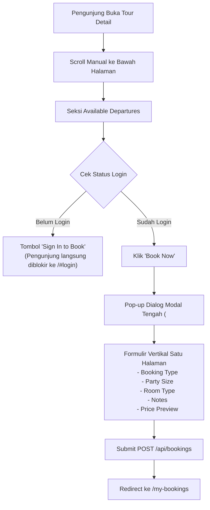
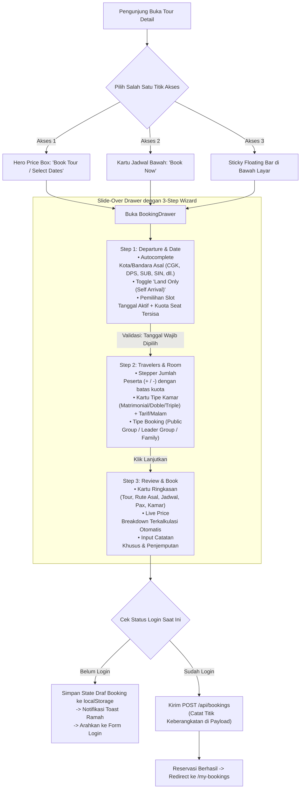

# Dokumen Spesifikasi & Aturan Bisnis: Alur Pemesanan Tur (Booking Flow)
## Analisis Komparatif: Sistem Existing vs Implementasi Baru (Keytours-Inspired)

> **Dokumen Versi:** 1.0  
> **Tanggal:** 17 Oktober 2026  
> **Target Analisis & Pembaruan:** Platform `tourops-app`  
> **Referensi Industri:** [Keytours Vacations](https://www.keytours.com/) (Ubud / Balinese Romance Vacation Package)  
> **Penulis:** Arsitek Solusi & Tim Rekayasa Perangkat Lunak Tourops  

---

## 1. Eksekutif Ringkasan & Latar Belakang

Pada platform tur modern seperti **Keytours Vacations**, pemesanan paket perjalanan (*customizable packages*) tidak diperlakukan seperti pembelian barang e-commerce statis. Pelanggan memerlukan fleksibilitas dalam menentukan:
1. **Dari mana mereka memulai perjalanan (*Departure City / Hub*)** — apakah memerlukan penjemputan dari kota asal (e.g. Jakarta, Surabaya, Singapore) atau bertemu langsung di destinasi (*Land Only / Self Arrival*).
2. **Kapan mereka berangkat (*Departure Date*)** — memilih tanggal dengan visualisasi ketersediaan kuota (*remaining spots*) dan transparansi harga per orang.
3. **Konfigurasi akomodasi & peserta (*Party Size & Room Types*)** — kalkulasi biaya kamar per malam yang adil dan transparan.

Dokumen ini menyajikan pemetaan aturan teknis dan bisnis secara komprehensif, membandingkan sistem **Existing** (alur lama sebelum pembaruan) dengan **Implementasi Baru** (*BookingDrawer Multi-step*).

---

## 2. Bedah Aturan Lengkap: Sistem Existing (Lama)



### 2.1 Aturan UI/UX Existing
1. **Aksesibilitas Tombol Booking:**
   - Tidak ada tombol pemesanan di bagian atas (*hero section*).
   - Tidak ada bar mengambang (*sticky bar*) saat pengguna melakukan scrolling.
   - Pengguna dipaksa membaca seluruh deskripsi, foto galeri, ringkasan *highlights*, *inclusions/exclusions*, *day-by-day itinerary*, data pemandu (*tour guides*), dan daftar hotel hingga ke ujung bawah halaman untuk menemukan tombol booking.
2. **Penanganan Pengunjung Tamu (*Unauthenticated Guest*):**
   - Jika pengunjung belum login, tombol booking pada jadwal departure langsung digantikan dengan link `<a href="/#login"><Button>Sign In to Book</Button></a>`.
   - Tamu **sama sekali tidak dapat**:
     - Menguji pilihan tipe kamar (*Matrimonial / Doble / Triple*).
     - Mengubah jumlah peserta (*party size*).
     - Melihat kalkulasi rincian harga total (*price preview*).
3. **Format Formulir Pemesanan:**
   - Menggunakan komponen dialog modal standar (`<Dialog>`) yang muncul di tengah layar.
   - Seluruh field ditumpuk secara vertikal dalam satu tampilan sempit tanpa tahapan progresif (*stepper*).

### 2.2 Aturan Bisnis & Data Existing
1. **Kota Keberangkatan (*Departure City*):**
   - **Nihil.** Tidak ada mekanisme bagi customer untuk memilih kota asal keberangkatan atau titik penjemputan.
   - Sistem mengasumsikan seluruh peserta otomatis tiba di meeting point tanpa koordinasi asal keberangkatan pada record `bookings`.
2. **Kalkulasi Harga:**
   - Menggunakan per-person base price dari `tour_departures.pricePerPerson` (atau fallback ke `tours.basePrice`).
   - Biaya akomodasi kamar dihitung berdasarkan: `tarif_kamar_per_malam × jumlah_malam_tur × jumlah_kamar_yang_dibutuhkan`.
3. **Validasi Pemesanan:**
   - Kuota dibatasi oleh `capacityTotal - capacityBooked`.
   - Jika terjadi `currencyMismatch` (misal harga tur dalam USD tetapi hotel dalam EUR tanpa kurs live), tombol konfirmasi dinonaktifkan.

---

## 3. Bedah Aturan Lengkap: Sistem Implementasi Baru (Keytours-Inspired)



### 3.1 Aturan UI/UX Baru
1. **Multi-Entry Point (Omnipresent Booking Trigger):**
   - **Hero Price Box:** Tombol beraksen primer `"Book Tour / Select Dates"` terletak strategis di samping harga mulai.
   - **Departure Card Quick-Link:** Tombol `"Book Now"` pada masing-masing kartu jadwal di bawah langsung membuka drawer dengan tanggal tersebut dalam kondisi *pre-selected*.
   - **Sticky Floating Action Bar:** Bar mengambang dengan latar belakang *blur backdrop* di bagian bawah viewport layar (baik mobile maupun desktop), memastikan customer dapat memulai pemesanan kapan saja tanpa kehilangan konteks halaman.
2. **Slide-over Drawer Architecture:**
   - Menggunakan sheet drawer modern yang meluncur mulus dari sisi kanan layar (`side="right"`), memberikan ruang vertikal luas dan nyaman untuk membaca rincian biaya.
   - Menggunakan **Visual Stepper 3 Tahap** persis seperti arsitektur wizard Keytours.

---

### 3.2 Rincian Aturan Bisnis per Tahapan (*Step-by-Step Logic*)

#### STEP 1: Departure City & Date Selection (Keberangkatan & Tanggal)
* **Aturan Kota Keberangkatan (*Departure Hub*):**
  - Menyediakan direktori bandara dan kota keberangkatan populer:
    - *Domestik Utama:* Jakarta (CGK), Bali (DPS), Surabaya (SUB), Medan (KNO), Yogyakarta (YIA).
    - *Regional & Internasional:* Singapore (SIN), Kuala Lumpur (KUL), Sydney (SYD), Melbourne (MEL), Tokyo (HND/NRT), London (LHR), Amsterdam (AMS), New York (JFK), Los Angeles (LAX).
  - Dilengkapi fitur pencarian instan (*autocomplete*) berdasarkan nama kota, nama bandara, atau kode 3-huruf IATA.
  - Mendukung input kota kustom jika kota asal wisatawan tidak ada di daftar kurasi.
  - **Opsi Land Only (Self Arrival):** Wisatawan dapat mengaktifkan toggle *"Land Only"* jika mengatur tiket pesawat sendiri dan hanya membutuhkan paket darat + penjemputan di bandara destinasi lokal.
* **Aturan Pemilihan Tanggal (*Departure Dates*):**
  - Menampilkan seluruh slot `tour_departures` yang berstatus `open`.
  - Tiap slot wajib menampilkan:
    - Rentang tanggal: `startDate` — `endDate`.
    - Sisa kuota seat: `capacityTotal - capacityBooked` (dengan penanda visual jika kursi menipis).
    - Harga per orang terkonfirmasi.
  - **Validasi Guard:** Tombol *"Lanjutkan"* di Step 1 terkunci (*disabled*) jika customer belum memilih salah satu slot tanggal keberangkatan.

---

#### STEP 2: Travelers & Room Selection (Peserta & Alokasi Kamar)
* **Aturan Jumlah Peserta (*Party Size*):**
  - Input jumlah orang menggunakan tombol inkremen (`+`) dan dekremen (`-`).
  - Nilai minimum adalah **1 orang**.
  - Nilai maksimum dibatasi oleh sisa kuota kursi pada slot departure yang dipilih di Step 1:
    $$\text{Max Pax} = \max\Big(1, \, \text{capacityTotal} - \text{capacityBooked}\Big)$$
* **Aturan Tipe Kamar (*Room Type Allocation*):**
  - Hanya menampilkan tipe kamar yang didukung oleh hotel-hotel mitra pada tur tersebut (*Matrimonial, Doble, atau Triple*).
  - Menampilkan tarif kamar per malam terendah (*starting rate*) secara transparan.
  - Jumlah kamar yang dibutuhkan (*rooms needed*) dihitung otomatis berdasarkan kapasitas tipe kamar:
    - *Matrimonial / Doble:* Kapasitas 2 orang per kamar $\rightarrow \lceil \text{pax} / 2 \rceil$.
    - *Triple:* Kapasitas 3 orang per kamar $\rightarrow \lceil \text{pax} / 3 \rceil$.
* **Aturan Tipe Pemesanan (*Booking Types*):**
  - `join_public_group`: Bergabung dalam grup keberangkatan umum.
  - `leader_group`: Menginisiasi rombongan komunitas/keluarga besar (wajib menginput Nama Grup).
  - `private_family`: Pemesanan perjalanan privat khusus keluarga.

---

#### STEP 3: Review, Price Breakdown & Final Confirmation
* **Aturan Transparansi Rincian Harga (*Live Price Breakdown*):**
  - Mengambil data langsung dari endpoint kalkulator resmi `/api/tours/:tourId/price-preview`.
  - Rincian mencakup:
    1. Biaya Dasar Tur: $\text{Party Size} \times \text{Per-Person Price}$.
    2. Biaya Akomodasi Kamar: $\text{Rooms Needed} \times \text{Selected Room Rate} \times \text{Tour Nights}$.
    3. Grand Total yang telah disinkronkan mata uangnya (`USD`).
* **Aturan Catatan Khusus & Logistik Penjemputan:**
  - Menyediakan kolom teks bebas untuk mencatat nomor penerbangan, waktu mendarat, kebutuhan makanan khusus (halal/vegetarian), atau kebutuhan aksesibilitas.
  - Kota keberangkatan yang dipilih di Step 1 otomatis di-tag ke dalam format catatan:
    `[Departure: <City / Land Only>] <User Notes>`.
* **Aturan Autentikasi Progresif (*Progressive Auth Guard*):**
  - **Customer Terautentikasi:** Menampilkan tombol *"Konfirmasi Booking"* dan langsung mengeksekusi mutasi `POST /api/bookings`.
  - **Pengunjung Belum Login (Tamu):**
    - Tidak diblokir sejak awal.
    - Menampilkan kartu edukasi: *"Simpan Draf & Masuk Akun"*.
    - Tombol menampilkan label *"Masuk & Konfirmasi"*.
    - Saat ditekan, preferensi booking disimpan ke `localStorage("tourops_pending_booking")` dan pengguna diarahkan ke modal login. Setelah login selesai, pengguna tidak perlu mengisi ulang dari awal.

---

## 4. Matriks Komparatif Menyeluruh

| Parameter Evaluasi | Sistem Lama (Existing) | Implementasi Baru (Keytours-Inspired) | Keuntungan Bisnis & Operasional |
| :--- | :--- | :--- | :--- |
| **Pemilihan Kota Asal** | ❌ Tidak ada | ✅ Lengkap (Hub IATA, pencarian instan, toggle Land Only) | Tim operasional tur mengetahui titik kumpul & rencana kedatangan traveler secara akurat. |
| **Format Kalender Tanggal** | ⚠️ Tabel linear kaku di bagian paling bawah halaman | ✅ Kartu interaktif di Step 1 dengan sisa seat & harga live | Traveler mendapatkan kepastian tanggal & ketersediaan kuota dalam satu pandangan. |
| **Aksesibilitas Aksi Booking** | ❌ Wajib scroll sampai dasar halaman | ✅ 3 Titik Akses: Hero box, Departure card, Sticky bottom bar | Menghilangkan friksi konversi; traveler bisa memesan saat terinspirasi di bagian mana pun. |
| **Pemisahan Logika Form** | ⚠️ Semua input ditumpuk dalam 1 dialog modal sempit | ✅ 3-Step Wizard terstruktur (*Departure $\rightarrow$ Pax $\rightarrow$ Review*) | Mengurangi beban kognitif pengguna (*cognitive load*) dan mencegah kesalahan pengisian. |
| **Hak Akses Tamu (*Guest*)** | ❌ Terkunci total (*Login wall* sebelum form terbuka) | ✅ Tamu bebas menjelajah konfigurasi; login di akhir alur | Meningkatkan rasio konversi pendaftaran (*lead capture*) tanpa membuat traveler frustrasi. |
| **Kalkulasi Biaya Kamar** | ⚠️ Dropdown teks statis tanpa rincian malam | ✅ Kartu visual dengan tarif per malam & kalkulasi kamar otomatis | Transparansi harga mencegah komplain selisih biaya hotel pasca-booking. |
| **Penyimpanan Status Draf** | ❌ Hilang jika berpindah halaman atau login | ✅ Tersimpan otomatis di `localStorage` saat diarahkan login | Traveler tidak perlu mengulang proses seleksi tanggal dan kamar setelah proses login. |

---

## 5. Rekomendasi Integrasi Lanjutan (Backend & Skema DB)

Agar data titik keberangkatan yang dipilih pada frontend tersimpan secara independen dan terstruktur di level database (bukan sekadar teks pada kolom `notes`), langkah teknis backend yang direkomendasikan adalah:

1. **Pembaruan Skema Database (`lib/db/src/schema/schema.ts`):**
   ```typescript
   export const bookings = pgTable("bookings", {
     // ... kolom existing ...
     departureCity: text("departure_city"),
     departureAirportId: varchar("departure_airport_id"),
   });
   ```
2. **Pembaruan Validasi Skema Zod (`insertBookingSchema`):**
   Menerima field opsional `departureCity` dan `departureAirportId` pada payload pembuatan reservasi.
3. **Penyajian di Portal Operasional (`/ops/booking-operations/:id`):**
   Menampilkan badge kota keberangkatan pada daftar manifes penumpang sehingga Tour Leader dan Transport Manager dapat mengatur penjemputan bandara (*airport transfer*) secara otomatis.
