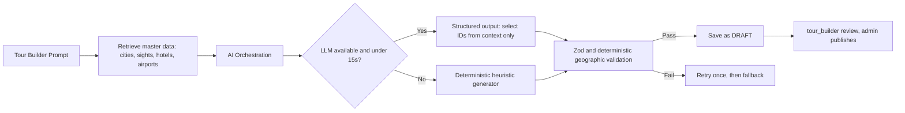

# PRD: TourOps Enterprise Platform (Revision 1.1, English)

**Version:** 1.1 | **Status:** Draft, pending Finance sign-off | **Date:** October 17, 2026 | **System:** TourOps Travel & Tour Management System (`tourops-app`) | **Audience:** Engineering, Product, Design, Operations, Finance, Legal

## 0. Revision History and How to Read This Document

| Version | Date | Summary |
| :-- | :-- | :-- |
| 1.0 | Oct 17, 2026 | Initial specification. |
| 1.1 | Oct 17, 2026 | Closes the installment-schedule gap, adds cancellation/refund/late-payment policies, seat hold, booking idempotency, KPI definitions, data privacy, RBAC matrix, test strategy, assumptions and open questions. User stories were renumbered (see sections 4 and 5). |

**Markers:**

- **\[PROPOSED\]**: a proposed default that must be approved by the relevant owner (Finance/Operations/Legal) before implementation.
- **\[FILL\]**: real data that is not yet available and must be supplied by the named owner.

**Corrections:** v1.0 claims 19 roles, but only 15 role codes are written explicitly. The remaining four must be taken from the `user_role` enum in the code (see section 3). The document status is lowered from “Approved” to “Draft” because Finance sign-off is outstanding, and v1.0 approvals must be reconfirmed for v1.1.

---

## 1. Executive Summary

### Problem

Traditional tour management relies on spreadsheets, disconnected supplier channels, rigid booking forms, and manual payment tracking. This causes booking errors, departure overbooking, slow responses to custom quotes, and an inflexible checkout for travelers who want staged payments.

### Solution

TourOps is a multi-portal tour-operator ERP and e-commerce platform: AI-assisted tour creation, a master catalog, 19-role RBAC, multi-step booking with departure city and date selection, automated installment schedules, and supplier workflow dispatch in one cloud-native application.

### KPIs and Measurement Definitions

| # | KPI | Measurement definition | Baseline | Target |
| :-- | :-- | :-- | :-- | :-- |
| 1 | Booking funnel conversion | Sessions that open the booking drawer → booking created (status `pending_payment` or later). Measured per 30-day period, non-bot sessions only. | \[FILL\] Analytics, measure 30 days before launch | +25% relative within 60 days of release |
| 2 | Checkout abandonment | Bookings that reach Step 3 but whose deposit is not paid within 24 hours, divided by all bookings reaching Step 3. | \[FILL\] Analytics | -35% relative within 60 days |
| 3 | Quote-to-booking time | Median business hours from quote/booking request submitted to status `confirmed` or proposal sent. | \[FILL\] Operations, sample 30 days | < 3 business hours (today about 48 hours) |
| 4 | Zero overbooking | Invariant `capacityBooked <= capacityTotal` on every departure; verified by a concurrency load test (200 parallel requests against 1 remaining seat must yield exactly 1 success) and a daily verification job. | 0 | 0 incidents, 0 invariant violations |
| 5 | Zero price anomalies | Price-calculation golden-set tests pass 100%, and for every booking the sum of all installments equals `totalPrice` exactly. | n/a | 0 anomalies in daily reconciliation |
| 6 | Performance and reliability | Catalog search: median ≤ 200 ms and p95 ≤ 600 ms \[PROPOSED\]. Server quote endpoint: p95 ≤ 300 ms. Client price preview: ≤ 50 ms. Uptime ≥ 99.9% monthly. RBAC authorization tests pass 100% on every CI run. | \[FILL\] | As defined in the column |
| 7 | Business metrics | Revenue, average booking value, % installments paid on time, % failed payments, cancellation rate, departure capacity utilization. | \[FILL\] Finance | Targets set by Finance before release |

---

## 2. Assumptions, Dependencies, and Open Questions

### Assumptions

1. A tour has one base currency; all departure, room, and installment prices use that currency.
2. Primary customers are individuals and travel advisors; payment is by card via Stripe, with bank transfers verified manually.
3. All due dates are computed in the operator timezone (`global_settings.operator_timezone`) \[FILL\].
4. Installment, refund, and tax rules are stored as versioned configuration, not hard-coded.

### Dependencies

Production Stripe account and keys, an SMTP provider, LLM access, Finance approval of payment policies, and Legal determination of legal and tax requirements.

### Open Questions

| # | Question | Owner | Needed before |
| :-- | :-- | :-- | :-- |
| Q1 | Are the installment figures (20/30/50 and 30/70) and the refund policy in section 5 approved? | Finance | End of Phase 1 development |
| Q2 | What are the four additional roles among the 19? | Engineering | Finalizing the RBAC matrix |
| Q3 | Are displayed prices tax-inclusive and service-fee-inclusive? What are the VAT rate and tax treatment of tours? | Finance, Legal | Phase 1 release |
| Q4 | Which data regulations apply (Indonesian PDP Law, GDPR for EU customers) and where is data stored? | Legal | Phase 1 release |
| Q5 | Is `SameSite=None; Partitioned` truly required (embed/white-label)? | Engineering | Phase 3 |
| Q6 | What is the cost limit per AI generation and the target model? | Product | Phase 1 |

---

## 3. Personas and RBAC Matrix

| Persona | Role | Primary goal |
| :-- | :-- | :-- |
| B2C traveler | `customer` | Browse tours, choose departure and rooms, pay in full or in installments, manage passenger details. |
| Travel advisor / group organizer | `customer` (`clientAccountType: group_organizer`) | Coordinate group bookings, share join codes, request custom proposals. |
| Tour builder and content editor | `tour_builder`, `content_editor` | Build itineraries, generate tours with AI, manage content. |
| Supplier | `hotel_manager`, `transport_manager`, `guide_manager`, `sights_manager`, `airline_supplier` | Manage rate cards and fulfill service requests. |
| Field operations | `tour_leader`, `operations_manager`, `city_manager`, `country_manager` | Monitor execution, manifests, incidents. |
| Finance and admin | `accounting`, `admin`, `super_admin` | Reconciliation, refunds, markup, supplier payments. |

### Permission Matrix

Key: **R** read, **W** write, **A** approve, **O** own records/entity only, **T** assigned territory/assignments only, **—** no access. The 4 remaining roles from the `user_role` enum (see Q2) must be added to this table in the same format before the document is approved.

| Role | Published tours | Draft tours | Price and publish status | Bookings | Payments/refunds | Supplier rate cards | Workflow | Audit log |
| :-- | :-- | :-- | :-- | :-- | :-- | :-- | :-- | :-- |
| `customer` | R | — | — | R/W (O) | R, pay (O) | — | — | — |
| `tour_builder` | R | R/W | W (price proposals), no publish | R | — | — | — | — |
| `content_editor` | R | R/W (description and itinerary only) | — | — | — | — | — | — |
| Suppliers (5 roles) | — | — | — | — | — | R/W (O) | R/W assigned steps (O) | — |
| `tour_leader` | R | — | — | R (T) | — | — | R/W (T) | — |
| `operations_manager` | R | R | — | R/W | — | R | R/W | R |
| `city_manager` | R | — | — | R (T) | — | R (T) | R/W (T) | — |
| `country_manager` | R | R (T) | — | R (T) | R (T) | R (T) | R/W (T) | R (T) |
| `accounting` | R | — | R | R | R/W, processes refunds | R | — | R |
| `admin` | R/W | R/W | W, A publish | R/W | R/W, A large refunds | A supplier accounts | R/W | R |
| `super_admin` | all | all | all | all | all | all | all | R/W |

General rules: fail-closed (no matching role → HTTP 403), draft tours that a caller may not see → HTTP 404, and every denial is recorded in `audit_logs`.

---

## 4. Module A: Tour Discovery and Booking

### US-01: Departure and Date Selection

*As a prospective traveler, I want to choose my origin city, an open departure date with capacity indication, and room occupancy, so that I see an accurate price without being forced to log in too early.*

- **AC-01.1** The booking trigger appears at three points: the hero price box, the inline “Available Departures” card table, and a bottom sticky bar that appears once the hero scrolls out of the viewport.
- **AC-01.2** Clicking a trigger opens a drawer (side sheet on desktop, bottom sheet on mobile) with 3 steps: (1) Date and City, (2) Room Configuration and Party Size, (3) Traveler Contact and Booking Review.
- **AC-01.3** Guests (not logged in) may complete Steps 1 and 2. The **price preview is computed on the client** from cached rate data and must appear within ≤ 50 ms. At Step 3 and on every change afterward, the client calls the server endpoint `POST /quotes` (p95 ≤ 300 ms). **The server price is authoritative**; if it differs from the preview, the UI shows the server price and explains the change.
- **AC-01.4** If not logged in at Step 3 submission, an inline login/registration form appears in the drawer. **State-storage decision: `sessionStorage`**, one key per tour, expiring after 2 hours, holding only non-sensitive choices (date, city, rooms, party size). Passport and contact data are never stored. State must survive refresh and OAuth redirects (via the `state` parameter).
- **AC-01.5** Closed, sold-out, or past departures render disabled with a badge (`Sold Out`, `Registration Closed`) and cannot be selected. When 5 or fewer seats remain, show “N seats left”.
- **AC-01.6** The drawer and stepper meet WCAG 2.2 AA: full keyboard navigation, focus trap, ARIA labels, minimum contrast, and screen-reader announcements for price changes.

### US-02: Room Configuration and Price Calculation

*As a traveler, I want to choose room types so that the total reflects nightly rates multiplied by duration.*

**Room types:** Matrimonial (one large bed, capacity 2), Doble (two beds, capacity 2), Triple (capacity 3). UI labels must be available in English and Indonesian.

**Total formula (server, authoritative):**

`Total = Adult Price + Child Price + Accommodation + Departure Surcharge + Single Supplement - Discount + Tax + Service Fee`

- **AC-02.1 Accommodation.** A booking stores `room_allocations = [{type, count}]` with the constraint that total capacity ≥ party size. `Accommodation = Σ (nightly rate of type × nights × count)`. Automatic allocation for a single type uses `ceil(party / room capacity)`. Mixed room types in one booking are allowed.
- **AC-02.2 Odd party size.** If one traveler occupies a room of capacity 2 or 3 alone, the system adds a **single supplement** at the per-departure rate. Roommate matching is out of scope.
- **AC-02.3 Children.** Child price = adult price × `child_ratio` (set per departure by `tour_builder`/`admin`, 0 < ratio ≤ 1). The server rejects any value exceeding the adult price. Age definitions \[PROPOSED\]: child 2 to 11 years; infants under 2 travel free without a seat.
- **AC-02.4 Departure surcharge.** Computed per departure (season/origin city) as a fixed amount or percentage, stored on `tour_departures`.
- **AC-02.5 Discount.** One promo code per booking, validated server-side, non-stackable \[PROPOSED\].
- **AC-02.6 Tax and service fee.** Rates are configured in `global_settings` per country/tour. Displayed prices are **tax-inclusive** \[PROPOSED, Q3\]; the tax breakdown appears in the booking review.
- **AC-02.7 Rounding.** Each line is rounded ROUND\_HALF\_UP to the currency’s minor unit (IDR 0 decimals, USD 2 decimals). All money values are stored as `numeric(14,2)` (never float) and sent to the gateway as integer minor units.
- **AC-02.8 Currency.** All prices use the tour currency. If hotel rates use a different currency, the server uses an exchange rate from `global_settings` with an `effective_date` and a maximum age of 24 hours. If the rate is missing or stale, the UI shows a mismatch notice and checkout is blocked. Conversion is informational; payment is always in the tour currency.

### US-03: Capacity Hold and Booking Idempotency

*As an operator, I want seats held in a controlled way and booking creation to be duplicate-safe, so there is no overbooking or duplicate booking.*

- **AC-03.1** When a booking is created (status `pending_payment`), the server decrements capacity in one transaction using `SELECT ... FOR UPDATE` on the `tour_departures` row and sets `hold_expires_at = now + 30 minutes` \[PROPOSED\].
- **AC-03.2** A deposit paid before `hold_expires_at` moves the status to `confirmed`. Otherwise a per-minute job sets the status to `expired` and releases capacity.
- **AC-03.3** If a successful payment arrives after the hold has expired, the system tries to re-acquire the seat; if capacity is unavailable, the payment is automatically refunded in full and the customer is notified.
- **AC-03.4** `POST /bookings` requires an `Idempotency-Key` header (a UUID per checkout session). The same key with the same payload returns the original booking; the same key with a different payload returns 422. Keys are retained for 24 hours. The submit button is disabled while a request is in flight.

**Booking state machine:** `pending_payment` → `confirmed` → `completed`; branches: `expired`, `cancelled_unpaid`, `cancelled_by_customer`, `cancelled_by_operator`.

---

## 5. Module B: Staged Payments, Late Payments, and Refunds

### US-04: Installment Schedule (Deposit and Installments)

*As a customer, I want to choose between paying in full or in stages so that I can secure my booking with a deposit.*

The scheme depends on **D = number of days from the booking date to the departure date** \[PROPOSED, pending Q1\]:

| D | Scheme |
| :-- | :-- |
| D ≤ 30 | Full payment, 100% at checkout. |
| 31 ≤ D ≤ 90 | 2 installments: 30% deposit at checkout, 70% due at D-30. |
| D ≥ 91 | 3 installments: 20% at checkout, 30% due at D-90, 50% due at D-30. |

The v1.0 gap (bookings made 31 to 89 days before departure, when D-90 had already passed) is closed by the 2-installment scheme.

- **AC-04.1** The system creates `booking_payment_schedules` rows when the booking is created. No `dueDate` may be earlier than the booking date. The customer can always choose to pay in full and may pay early.
- **AC-04.2 Rounding.** All installments except the last are rounded per AC-02.7; **the last installment = total minus the sum of earlier installments**, so the sum of installments always equals `totalPrice` exactly (a tested invariant).
- **AC-04.3** Installment rules are read from versioned configuration, and a **schedule snapshot is stored per booking**; rule changes do not affect existing bookings.
- **AC-04.4** A successful payment webhook updates `paidAmount` and status (`pending` → `partially_paid` → `paid`) atomically.
- **AC-04.5** Partial or unallocated payments apply to the oldest pending installment, then flow to the next. Payments exceeding the outstanding balance are rejected (intent amount ≤ outstanding).
- **AC-04.6** `/my-bookings/:id` and `/checkout/:id` show an installment timeline: status badges, due dates, remaining balance, and a “Pay Installment” button.
- **AC-04.7 Email reminders** are sent relative to each installment’s due date: D-7, D-1, and on the due date (replacing the 60/30-day reminders in v1.0, which matched no milestone).

### US-05: Gateway Abstraction and Idempotent Webhooks

- **AC-05.1** A provider interface (`createIntent`, `confirmPayment`, `handleWebhook`, `refundPayment`) with Stripe and internal test implementations.
- **AC-05.2** Webhooks must verify the HMAC signature; an invalid signature is rejected with HTTP 400 and logged.
- **AC-05.3** Events are recorded in `payment_events` with a unique constraint on `(provider, event_id)`, inside the same database transaction as the payment status change. A replayed event returns `200 OK` `{ status: "duplicate_ignored" }` without changing accounting state.
- **AC-05.4 Bank transfer (manual).** The customer uploads proof of transfer; status `awaiting_verification`; `accounting` verifies with a target SLA \[FILL\]. Verification triggers the same flow as a successful payment.
- **AC-05.5** A daily reconciliation job compares Stripe transactions with `payment_events` and reports discrepancies to `accounting`.

### US-06: Late Payments

*As an operator, I want firm rules for installments that pass their due date.*

- **AC-06.1** An installment past its due date has status `overdue`; reminders are sent at D+1 and D+3.
- **AC-06.2** Grace period of 3 days \[PROPOSED\]. After that the booking becomes `cancelled_unpaid`, remaining schedule rows are cancelled, and capacity is released.
- **AC-06.3** The deposit is non-refundable when cancellation results from non-payment \[PROPOSED, Q1\]; there is no late fee.
- **AC-06.4** `accounting` may extend the grace period manually with a mandatory reason recorded in `audit_logs`.

### US-07: Customer Cancellation and Refunds

*As a customer, I want to know clearly how much I get back if I cancel.*

Policy \[PROPOSED, Q1\], calculated on the total amount paid, based on days remaining to departure at cancellation:

| Days remaining | Refund |
| :-- | :-- |
| ≥ 91 | 100% minus a fixed administration fee \[FILL\] |
| 61 to 90 | 70% |
| 31 to 60 | 40% |
| ≤ 30 | 0% |

- **AC-07.1** The UI shows the refund calculation before the customer confirms cancellation.
- **AC-07.2** Non-refundable supplier costs \[FILL\] may reduce the refund, with a written breakdown.
- **AC-07.3** Refunds go to the original payment method through `refundPayment`; partial refunds are supported. Refunds above a threshold \[FILL\] require `admin` approval; `accounting` processes them.
- **AC-07.4** Unpaid installments are cancelled, the status becomes `cancelled_by_customer`, capacity is released, and every step is recorded in `audit_logs`.

---

## 6. Module C: Groups and Passenger Management

### US-08: Group Invitations and Shared Bookings

*As a group organizer, I want to invite participants with a join code so that each participant fills in their own travel details.*

- **AC-08.1** Every group booking generates a unique alphanumeric `join_code` (at least 8 characters, cryptographically random).
- **AC-08.2** `/join/:joinCode` lets an authenticated traveler join the manifest. Joiners **must fit within the party size (`partySizeExpected`) already held** on the booking; if it is full, the join is rejected. Adding people beyond that requires a booking change (US-11) and a departure capacity check.
- **AC-08.3** Repeated self-joins by the group leader, and joins to bookings with status `cancelled_*` or `expired`, return explicit validation errors.
- **AC-08.4** The organizer pays for the whole booking; per-participant payment tracking is informational (the organizer records each participant’s share) and does not change the installment schedule \[PROPOSED\].
- **AC-08.5** `manage-passengers.tsx` accepts legal full name as on the passport, date of birth, passport number, passport expiry date, nationality, and dietary/medical notes. Validation: passport valid for at least 6 months after the return date \[PROPOSED\].
- **AC-08.6** Passport data and medical notes are treated as sensitive data (see section 9).

---

## 7. Module D: Operations, Suppliers, and RBAC

### US-09: RBAC and Row-Level Data Isolation

- **AC-09.1** All API routes enforce `requireRole(...)` server-side, per the matrix in section 3.
- **AC-09.2** Suppliers are restricted to records belonging to their **supplier entity** (`supplier_entity_id`), not merely `createdBy`. Several users can belong to one supplier entity through a `supplier_members` table; `createdBy` is recorded for audit only.
- **AC-09.3** Content editors may change only descriptions and itineraries. `basePrice`, departure prices, and publish status are protected by PATCH allowlists (HTTP 403 for forbidden fields, 400 for unknown fields).
- **AC-09.4** Draft tours return HTTP 404 for anonymous visitors and customers (`AUTHZ-01`).
- **AC-09.5** Automated authorization tests cover every role × endpoint combination from the matrix and must pass 100% in CI.

### US-10: Booking Fulfillment Workflow Steps

- **AC-10.1** When a booking reaches `confirmed` (deposit paid), the system creates a `booking_workflows` entry with `workflow_steps`: Airline, Hotel, Transport, Guide, Sights.
- **AC-10.2** Each step stores status (`pending`, `assigned`, `confirmed`, `completed`), notes, assigned supplier/staff ID, and timestamped audit logs.
- **AC-10.3** The `/admin/workflow-detail.tsx` UI supports inline note editing and status transitions. An automatic alert is raised if a step is unfulfilled at D-14.
- **AC-10.4** Cancelling a booking cancels all active workflow steps and notifies the affected suppliers.

### US-11: Customer Booking Changes

*As a customer, I want to change my booking before departure.*

- **AC-11.1** Customers can request a change of date, party size, or room type up to D-30 \[PROPOSED\]. After that, changes go through `operations_manager` only.
- **AC-11.2** The server recalculates the price and installment schedule; the difference is billed as an additional installment or refunded per the US-07 policy. Old and new departure capacity are locked in one transaction.
- **AC-11.3** Date changes incur a change fee \[FILL, Finance\] and are allowed only to departures with status `open`.

### US-12: Operator-Initiated Departure Cancellation or Change

- **AC-12.1** If the minimum number of participants is not reached, `operations_manager` may cancel a departure no later than D-\[FILL\] days; all related bookings become `cancelled_by_operator`.
- **AC-12.2** Customers receive a cancellation email and may choose an automatic full refund (no deductions) or a free transfer to another departure.
- **AC-12.3** Automatic refunds are processed through `refundPayment` and the outcome is reported to `accounting`.

### US-13: Custom Quote Requests and Proposals

*As a travel advisor, I want to request a custom proposal and get a fast answer.*

- **AC-13.1** A quote request form (destination, dates, party size, budget, notes) creates a `quote_requests` entity that is auto-assigned to an available `tour_builder`.
- **AC-13.2** A proposal contains the itinerary, price breakdown, and validity period; the customer can accept it to create a booking directly.
- **AC-13.3** Response SLA is monitored as part of KPI 3 (quote-to-booking time).

### US-14: Search and Catalog

- **AC-14.1** The catalog supports text search, filters (destination, duration, price range, departure month, origin city), and sorting (price, nearest date, popularity).
- **AC-14.2** Performance follows KPI 6; results include published tours only.

### Non-Goals

- **Real-time GDS ticketing** (Amadeus/Sabre); flights use agency rate cards, manual PNRs, and simulated pricing.
- **Crypto and direct cash settlement**; payments are limited to cards via the gateway and manually verified bank transfers (US-05).
- **Native iOS/Android apps.** Mobile is served by a responsive PWA. Clarification: the PWA and offline capability for manifests (Phase 3) are **not** covered by this exclusion; only separate native binaries are excluded.
- **Open marketplace for unverified suppliers**; all supplier accounts and rate cards need HQ Admin approval.

---

## 8. AI System Requirements (Itinerary Generator)

The generator in `admin/tour-generator.tsx` uses an LLM with a **configurable** model (default and per-generation cost limit set by Product, Q6) and a deterministic heuristic fallback.

### Requirements

1. **Master-data context.** Before generation, the system retrieves `cities`, `sights`, `hotels`, and `airports` for the destination country and sends only public master data to the LLM provider. **No customer personal data is sent.**
2. **Structured output.** The LLM must produce JSON matching the `InsertTour`, `InsertTourDay`, and `InsertTourDayItem` schemas, and may only **reference entity IDs provided in the context**, never invent new entities.
3. **Deterministic post-generation validation.** Zod checks structure (sequential day numbers, valid times, non-empty descriptions), and a geographic checker ensures every sight/hotel belongs to the destination city or an adjacent metropolitan cluster. With ID references and this validation, the 100% geographic-consistency target is technically guaranteed rather than dependent on model behavior.
4. **Mandatory human review.** AI output is **always saved as `draft`**, never published directly. `tour_builder` reviews it, and only `admin` can publish.
5. **Latency and fallback.** Target: pipeline completes in ≤ 8 seconds for tours up to 14 days. Between 8 and 15 seconds the UI shows progress and the pipeline keeps running; at 15 seconds (hard limit) the request is cancelled and the heuristic fallback activates without a 500 error. The fallback also activates if credentials are missing or quota is exhausted.
6. **Security.** Master data is treated as data, not instructions (clear delimiters in the prompt); LLM output is never executed and has no tool access. Prompts and responses are logged without PII for audit.
7. **Evaluation.** A fixed evaluation dataset (at least \[FILL\] prompts across countries and durations) runs in CI: 100% schema pass rate, 100% geographic consistency, with fallback rate and cost per generation reported.
8. **Phase 3, KeyBrain AI.** Requirements are detailed in a separate document before Phase 3 starts (scope: natural-language itinerary tailoring, permission limits, and human review).

---

## 9. Technical Specifications

### Architecture

`pnpm` monorepo: React 19 + Vite frontend (Wouter, TanStack Query v5, Radix UI, Tailwind, vaul), Express 5 API with `express-session` + `connect-pg-simple`, auth and RBAC middleware (`requireRole`), Drizzle ORM on PostgreSQL 16, and shared packages `@workspace/db`, `@workspace/api-zod`, `@workspace/api-client-react`.

**BullMQ + Redis usage** (previously unexplained): queues for (1) transactional email and installment reminders, (2) PDF generation (invoices, vouchers, itineraries), (3) hold-expiry and reconciliation jobs, (4) long-running AI generation. Redis and the queues are added to the integration list and to monitoring.

**PDF documents:** invoice per payment, booking confirmation, daily vouchers, and itinerary. Generated via the queue, stored encrypted, and accessible only to the booking owner.

### Core Data Models

- **`tours`, `tour_departures`:** `tours` holds title, slug, duration, inclusions, `basePrice`, currency. `tour_departures` holds dates, capacity (`capacityTotal`, `capacityBooked`), `pricePerPerson`, `child_ratio`, surcharge, status (`open`, `closed`, `sold_out`, `cancelled`), with CHECK `capacityBooked <= capacityTotal`.
- **`bookings`:** `bookingCode`, `partySizeExpected`, `room_allocations`, `accommodationCost`, `departureCity`, `departureAirportId`, `totalPrice`, `status`, `hold_expires_at`, `idempotency_key`.
- **`booking_payment_schedules`:** `installmentNumber`, `label` (multi-language), `percentage`, `amount`, `dueDate`, `paidAmount`, `status` (`pending`, `partially_paid`, `paid`, `overdue`, `cancelled`).
- **`payment_events`:** unique `(provider, event_id)`, payload hash, processing status.
- \*\*`booking_workflows`, `workflow_steps`, `quote_requests`, `supplier_members`, `audit_logs`.
- **`user_profiles`:** `userId`, `role` (`user_role`), `clientAccountType`.
- All money columns are `numeric(14,2)`; input validation uses Zod with the regex `^\d+(\.\d{1,2})?$` (at most 2 decimals, non-negative), adjusted to each currency’s minor unit.

### Integrations

PostgreSQL (connection pooling, automated migrations), persistent cookie-based sessions, Stripe (`stripe`, `@stripe/stripe-js`) and the internal test provider, SMTP via Nodemailer, Redis for queues.

### Security, Privacy, and Compliance

1. **Authentication.** `bcryptjs` with salt rounds ≥ 10, minimum password length 8, session regeneration on login (`AUTH-02`), per-IP rate limiting and a 15-minute account lock after 5 failures (`AUTH-07`), TOTP 2FA (`otplib`) **mandatory for `admin`, `super_admin`, and `accounting`** \[PROPOSED\].
2. **Cookies and CSRF.** Session cookies are `Secure` and `HttpOnly`. `SameSite=None` and `Partitioned` are used only if a cross-site scenario is truly required (Q5); otherwise use `SameSite=Lax`. CSRF protection is mandatory: anti-CSRF tokens (double-submit or custom header) for all state-changing requests, plus `Origin` checks.
3. **Authorization.** Fail-closed, row-level isolation for suppliers and regional managers, a single source of truth for role-to-dashboard mapping in `src/lib/roles.ts`.
4. **Personal data protection.** Passport data, date of birth, and medical notes: encrypted at rest (encrypted columns or application-level encryption) and in transit (TLS), access limited to roles that need it and recorded in the audit log, masking in the UI (passport number partially shown), retention \[FILL, Legal\] followed by deletion or anonymization, and flows for data subjects to request access and deletion. Compliance follows the Indonesian PDP Law and GDPR where EU customers exist (Q4). Explicit consent is requested for medical data.
5. **PCI-DSS.** Card data **never touches TourOps servers**; card entry uses Stripe Elements/Checkout, keeping scope at SAQ A. The server stores only tokens and the last four digits.
6. **Legal and tax.** Terms and conditions and the cancellation policy must be accepted by the customer at Step 3 (acceptance is recorded with version and timestamp). Tax follows AC-02.6. Travel-agency licensing requirements are reviewed by Legal (Q4).
7. **Validation and audit.** Zod on all inputs; `audit_logs` records user ID, IP, changed fields, and time for all financial, role, and price changes.

### Non-Functional Requirements

- **Reliability:** uptime ≥ 99.9%, RPO ≤ 15 minutes and RTO ≤ 4 hours \[PROPOSED\], daily PostgreSQL backups with point-in-time recovery and a quarterly restore test.
- **Observability:** structured logging, metrics (latency, error rate, queue depth), tracing, and alerts for webhook failures, stuck queues, reconciliation discrepancies, and 5xx spikes.
- **Scalability:** designed for a baseline of \[FILL\] concurrent users and \[FILL\] bookings per hour at promotional peaks; final figures drive load tests.
- **Accessibility:** WCAG 2.2 AA across all customer flows.
- **Localization:** UI and emails in English and Indonesian; dates, numbers, and currency follow locale; the operator timezone is used for all deadlines.

### Test Strategy

1. **Unit:** price calculation (golden set including odd party sizes, children, mixed rooms, rounding), installment schedule generation for D = 30, 31, 90, 91, and the invariant sum of installments = total.
2. **Integration:** idempotent webhooks and replays, hold-expiry, refunds, late-payment flow.
3. **Concurrency:** 200 parallel requests against 1 remaining seat must produce exactly 1 booking; double-submit tests with `Idempotency-Key`.
4. **Authorization:** automated role × endpoint matrix (US-09).
5. **End-to-end:** guest → login → booking → deposit → installment → cancellation, on desktop and mobile.
6. **Accessibility, performance, and security:** automated audits (axe), load tests against KPI 6 targets, dependency scanning and a penetration test before production release.
7. **AI:** the evaluation dataset (section 8) runs in CI.

---

## 10. Phased Roadmap and Risks

### Roadmap

| Phase | Scope | Period | Status |
| :-- | :-- | :-- | :-- |
| 1a | Master data and tour catalog polish | Aug 1 to Aug 15, 2026 | Done |
| 1b | 19-role RBAC security hardening | Aug 16 to Aug 31, 2026 | Done |
| 1c | Sticky drawer and departure date selection | Sep 1 to Sep 30, 2026 | Done |
| 1d | Installment schedule (DB and UI), late-payment rules, refunds, seat hold, idempotency | Oct 1 to Oct 25, 2026 | In progress (scope expanded by this revision; schedule needs review) |
| 2a | Live Stripe integration, webhook sync, reconciliation | Oct 26 to Nov 15, 2026 | Planned |
| 2b | Automated workflow step dispatcher, installment reminders | Nov 16 to Nov 30, 2026 | Planned |
| 2c | Supplier self-service portal (Excel import/export) | Dec 1 to Dec 20, 2026 | Planned |
| 3a | Travel advisor white-label engine, commissions | Jan 5 to Jan 31, 2027 | Planned |
| 3b | KeyBrain AI, offline PWA for manifests and vouchers | Feb 2027 | Planned (separate requirements) |

### Risks and Mitigations

| Risk | Severity | Likelihood | Owner | Mitigation |
| :-- | :-- | :-- | :-- | :-- |
| High-concurrency overbooking | Critical | Medium | Engineering | Transactions with `FOR UPDATE`, CHECK constraint, concurrency tests, invariant verification job. |
| Webhook replay and race conditions | High | Medium | Engineering | `payment_events` unique `(provider, event_id)` inside a transaction, daily reconciliation. |
| Passport/medical data leak | High | Low | Engineering, Legal | Encryption, least-privilege access, audit log, retention and deletion. |
| Installment/refund policy not approved or changed | High | Medium | Finance | Versioned configuration rules, per-booking snapshot, Q1 decided before release. |
| Currency mismatch | Medium | High | Engineering, Finance | Server validation, exchange rates at most 24 hours old, checkout blocked. |
| AI outage or hallucination | Medium | Medium | Product | Deterministic fallback, ID references, validation, mandatory draft review. |
| Stripe dependency (outage, account closure) | Medium | Low | Finance, Engineering | Abstract provider interface, backup provider evaluated before Phase 3. |
| Low supplier adoption | Medium | Medium | Operations | Excel templates, guided onboarding, incentives. |
| Phase 2 delay | Medium | Medium | Product | MoSCoW prioritization and Phase 3 scope cuts if needed. |
| Regulatory change (PDP, tax) | Medium | Low | Legal | Quarterly Legal review, configuration-based tax rules. |
| Supplier rate card schema drift | Low | Low | Engineering | `MONEY_RE` regex validation and Excel templates with cell validation. |

### Prioritization (MoSCoW)

- **Must:** US-01 to US-07, US-09, US-10 (core flow, payments, security).
- **Should:** US-08, US-11, US-12, US-14.
- **Could:** US-13 (full proposal automation), additional reminders.
- **Won’t (this release):** items under Non-Goals.

---

## 11. Glossary

| Term | Meaning |
| :-- | :-- |
| Departure | A specific scheduled departure of a tour with its own capacity and price. |
| Seat hold | Temporary capacity reservation while a booking awaits payment. |
| Deposit | The first installment, paid at checkout. |
| Single supplement | Extra charge for a traveler occupying a room alone. |
| Matrimonial, Doble, Triple | Room types: one large bed (2 people), two beds (2 people), and 3 people. |
| Idempotency | The property that repeating an operation yields the same result. |
| RPO / RTO | Maximum acceptable data loss / maximum time to restore service. |
| PWA | Progressive web app that is installable and works offline. |

---

## 12. Review and Approvals

v1.0 approvals do not automatically carry over to v1.1 because scope and policies changed.

| Role | Reviewer | Status | Date |
| :-- | :-- | :-- | :-- |
| Lead Solutions Architect | Engineering Team | Reconfirmation needed for v1.1 | Scheduled |
| Head of Tour Operations | Operations Director | Reconfirmation needed for v1.1 | Scheduled |
| Finance Controller | Accounting Lead | Pending sign-off (required: Q1, Q3) | Scheduled |
| Legal | \[FILL\] | Pending review (Q3, Q4) | Scheduled |
