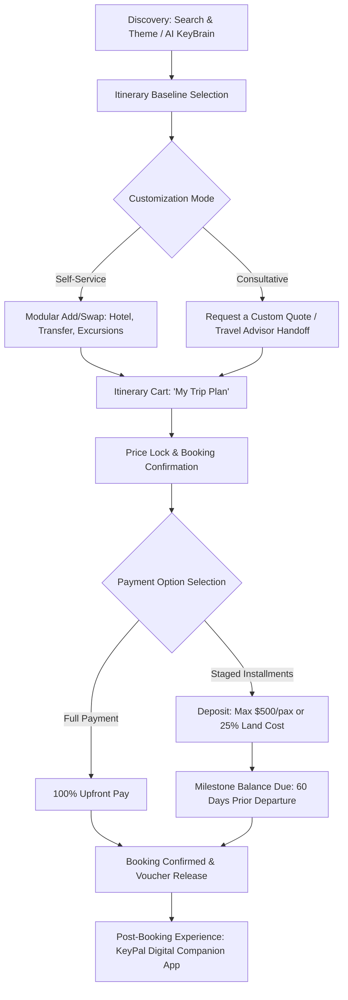

# Riset Arsitektur Bisnis & Frontend: Keytours Vacations (keytours.com)
Sebagai Referensi Modernisasi Platform Tourops App

> **Tanggal Riset:** 17 Oktober 2026  
> **Target Analisis:** [Keytours Vacations](https://www.keytours.com/)  
> **Tujuan:** Membedah flow bisnis, model komersial (deposit & cicilan), serta arsitektur frontend web app untuk dijadikan panduan pembaruan arsitektur pada platform `tourops-app`.

---

## 1. Profil & Model Bisnis Keytours Vacations

Keytours Vacations (berdiri sejak 1992, berbasis di Fairfax, Virginia, USA) bukan sekadar OTA (*Online Travel Agent*) agregator masal (seperti Expedia atau Booking.com), dan bukan pula operator tur bus kaku (*rigid group tours*). Model bisnis Keytours adalah **Customizable Tour Operator & Wholesaler** dengan positioning *high-touch + high-tech*.

### 1.1 Tiga Pilar Distribusi (Channels)
1. **Direct-to-Consumer (B2C):**
   - Wisatawan perseorangan/keluarga mencari paket liburan berbasis kurasi tematik (e.g. *Europe by Rail*, *Romantic Escapes*, *Food & Wine*).
   - Paket berfungsi sebagai **baseline/template itinerary** yang dapat disesuaikan (swap hotel bintang 3/4/5, tambah private transfer, ubah durasi).
2. **B2B Travel Advisors (Virtuoso, Travel Leaders, Signature Travel Network):**
   - Agen perjalanan independen memesan atas nama klien mereka.
   - Menyediakan fitur *Agent Portal*, komisi agen otomatis, *white-label client proposal*, dan *co-branded digital itineraries*.
3. **Custom Groups Department (`groups.keytours.com`):**
   - Penanganan khusus untuk grup 10+ orang (rombongan sekolah, tur religi, reuni keluarga besar, korporat).
   - Memiliki workflow terpisah: negosiasi kuota kamar hotel/bus rombongan, portal registrasi peserta individu, dan split payment per anggota grup.

---

## 2. End-to-End Business Flow (Alur Bisnis)

### 2.1 Alur Penemuan & Kustomisasi (Discovery & Build)
1. **Multi-Faceted Search:**
   - Pengguna memilih berdasarkan:
     - **Destinations** (Kota, Negara, Region).
     - **Vacation Types** (Rail journeys, Self-drive, Island hopping, Escorted tour).
     - **Transport Options** (Kereta antar kota, ferry, sewa mobil).
     - **KeyBrain AI Assistant:** Chatbot berbasis preferensi cerdas untuk menyusun multi-city itinerary dalam hitungan detik.
2. **Modular Itinerary Assembly:**
   - Pengguna tidak dipaksa membeli paket kaku. Setiap hari memiliki komponen terpisah:
     - *Lodging* (Pilihan bintang 3, 4, atau 5).
     - *Transportation* (High-speed rail ticket class, private chauffeur, group shuttle).
     - *Experiences & Excursions* (Skip-the-line museum ticket, cooking class, walking tour).

### 2.2 Aturan Deposit, Pembayaran & Termin Komersial
Berdasarkan *Terms & Conditions* resmi Keytours:
- **Minimum Booking Value:** $1,000 per orang atau $2,000 per booking.
- **Deposit Policy:**
  - Minimal **$500 per orang** ATAU **25% dari total biaya darat (*land package*)**, mana yang lebih besar.
  - Tiket pesawat (*airfare*) dan layanan khusus berstatus *instant-purchase/non-refundable* harus dibayar **100% di muka**.
- **Pelunasan (Final Balance Due):**
  - Wajib dilunasi paling lambat **60 hari sebelum tanggal keberangkatan**.
  - Jika booking dilakukan dalam rentang kurang dari 60 hari sebelum keberangkatan, wajib bayar **100% lunas langsung**.
  - Jika lewat dari batas waktu (toleransi hingga 35 hari sebelum berangkat tanpa kabar), sistem otomatis membatalkan reservasi dan deposit hangus.
- **Biaya Perubahan (*Amendment Fees*):**
  - Perubahan tanggal/layanan setelah konfirmasi dikenakan penalti administratif minimal $50 per perubahan plus selisih tarif operator lokal.

---

## 3. Bedah Arsitektur & Perilaku Frontend (keytours.com)

Analisis teknis langsung terhadap source code dan DOM runtime `https://www.keytours.com/`:

### 3.1 Tech Stack Frontend
- **Core Framework:** **Angular 21** dengan Server-Side Rendering (Angular SSR & Hydration via `ngh`).
- **UI Component Library:** **Angular Material 17/18+ (MDC-based)** (`mat-mdc-button`, `mat-mdc-form-field`, `mat-mdc-card`, `mat-mdc-tab-group`).
- **Enterprise Components:** **DevExtreme** (`dx-scroll-view`, `dx-drawer`, `dx-sortable`) untuk interaksi drag-and-drop dan scroll container berkinerja tinggi.
- **Theme & Layout Engine:** CSS Custom Properties terstruktur dengan dukungan dark mode dan token palet:
  - `--primary-color: #004E5A` (Deep Teal / Viridian mewah)
  - `--accent-color: #B69135` (Warm Gold / Mustard Gold)
  - `--secondary-color: #259191` (Cyan Teal)
  - `--surface-background: #FFFFFF / #F5F5F5`
  - Dark Mode: `#202828` & `#263232`
- **Tipografi:** Google Fonts:
  - Headings & Titles: `Playfair Display` (Serif elegan bernuansa *luxury travel*).
  - Body & Form Controls: `Nunito` / `Inter` (Sans-serif dengan keterbacaan tinggi).
- **Integrasi Pihak Ketiga:**
  - Trustpilot Reviews Widget (`tp-widget-reviews`).
  - Google Translate & Live Currency Converter dropdown di navbar atas.

---

### 3.2 Desain Komponen & Flow UX Kunci di Frontend

#### A. Header & Sticky Utility Bar
- **Top Utility Strip:** Nomor telepon bebas pulsa direct support (`1-800-576-1784`), link "For Travel Advisors", currency selector, dan widget bahasa.
- **Main Navigation Bar:**
  - Mega Menu interaktif untuk *Destinations* (Eropa, Mediterania, Afrika, dll).
  - *Vacation Styles* (Rail, Escorted, Self-drive).
  - *Custom Groups*.
  - Tombol aksi utama: **"Plan My Trip"** dan tombol drawer **"My Trip Plan (0)"**.

#### B. Hero Section dengan Multi-Tab Search Widget
- Widget pencarian terdiri dari tab switcher:
  - `Destinations`
  - `Vacations`
  - `Transport`
- Dilengkapi tombol toggle switcher: **"Use AI Assistant (KeyBrain)"** yang mengubah kolom pencarian standar menjadi conversational itinerary search prompt.

#### C. Itinerary Cart Drawer ("My Trip Plan")
Ini adalah pembeda paling signifikan antara Keytours dan toko online biasa:
- Bukan sekadar keranjang belanja produk statis.
- Menggunakan visual **Vertical Timeline**:
  - Garis vertikal penghubung (`trip-line`).
  - Indikator tanggal (`trip-date-circle` dengan format `Day 1 - Paris`, `Day 2 - Rome`).
  - Node item layanan (`trip-service-circle` dengan icon hotel, kereta, atau tur).
- Memungkinkan pengguna menambah atau menghapus segmen perjalanan secara dinamis sebelum masuk ke tahap Checkout / Quote Request.

#### D. Detail Itinerary & Customizer Page
- **Summary Header:** Menampilkan rute (*e.g. London to Paris by Eurostar*), durasi (7 Days / 6 Nights), hotel baseline, rating bintang, dan harga mulai dari (*From $X,XXX/pax*).
- **Day-by-Day Accordion:** Setiap hari menampilkan:
  - Destinasi dan rute perjalanan.
  - Aktivitas yang sudah termasuk (*Included*).
  - Slot kustomisasi: Dropdown untuk memilih hotel alternatif (e.g. Upgrade dari *Standard 3-Star* ke *Luxury 5-Star Boutique*).
  - Add-on excursions: Checkbox untuk menambahkan private tour tambahan.
- **Sticky Price Breakdown:** Saat pengguna mengubah hotel atau menambah tur, total kalkulasi harga diperbarui secara real-time di sidebar.

#### E. Portal Pasca-Booking: "KeyPal™" Digital Companion
- Setelah pemesanan selesai, traveler diberikan link akses ke web app responsif bernama **KeyPal™**.
- Berisi:
  - E-Voucher digital offline-ready untuk hotel dan tiket kereta.
  - Jadwal penjemputan sopir (*driver pickup times*) & kontak pemandu wisata lokal.
  - Layanan darurat 24/7 dan asisten navigasi kota.

---

## 4. Analisis Kesenjangan: Keytours vs Tourops App Saat Ini

| Fitur / Kemampuan | Keytours Vacations | Tourops App Saat Ini | Rekomendasi Pembaruan |
| :--- | :--- | :--- | :--- |
| **Model Pembayaran** | DP $500/25% + Pelunasan H-60 | DP 30% + Termin 40% + Termin 30% | Tambahkan aturan otomatis jatuh tempo H-60 dan validasi pelunasan langsung jika booking < 30/60 hari. |
| **Itinerary Builder** | Modular (bisa swap hotel, transport, excursion per hari) | Paket statis dengan fixed itinerary | Sediakan opsi Add-On atau sub-pilihan hotel/kamar saat checkout. |
| **Itinerary Cart** | Drawer timeline interaktif (*My Trip Plan*) | Checkout langsung per paket | Implementasikan timeline visual rute perjalanan di Order Summary checkout. |
| **Portal Pasca-Booking** | Digital Companion App (*KeyPal*) dengan live vouchers | Halaman riwayat booking & download PDF invoice | Lengkapi halaman `/my-bookings/:id` menjadi digital trip timeline & voucher wallet. |
| **Distribusi Agen B2B** | Virtuoso/Advisor Portal dengan komisi otomatis | Sistem peran admin/ops/customer umum | Tambahkan dukungan role `Agent` / `Partner` dengan komisi dan co-branded itinerary. |
| **Multilingual & Valuta** | Live Currency + Google Translation | Custom React i18n (`useLanguage` hook) | Pertahankan sistem i18n internal yang bersih dan tambahkan pemilih mata uang (USD, IDR, EUR). |
| **Desain & Estetika** | Luxury Teal (`#004E5A`) + Gold (`#B69135`), Serif font | Slate/Blue/Emerald modern | Mengadopsi palet warna mewah turisme premium (deep navy/teal + warm gold accents) dan tipografi serif untuk judul paket. |

---

## 5. Rekomendasi Teknis & Roadmap untuk Tourops App

### Tahap 1: Penyempurnaan Checkout & Payment Schedule Engine (Immediate Priority)
1. **Dynamic Due Date Calculation:**
   - Tambahkan logika tanggal jatuh tempo pelunasan dinamis di [checkout.tsx](file:///Users/wisnuflash/freelance/tourops-app/artifacts/tourops/src/pages/customer/checkout.tsx) dan [paymentRoutes.ts](file:///Users/wisnuflash/freelance/tourops-app/artifacts/api-server/src/routes/paymentRoutes.ts):
     - Jika selisih `departureDate - today <= 30 hari`: Wajib bayar lunas 100% (opsi cicilan di-disable otomatis).
     - Jika selisih > 30 hari: Munculkan opsi DP (30%) dan sisa tagihan dijadwalkan H-30 atau H-14 keberangkatan.
2. **Visual Order Summary with Route Timeline:**
   - Di panel ringkasan checkout, tambahkan mini-timeline rute (e.g. Day 1 -> Day N) agar traveler yakin dengan apa yang dibayar sebelum menekan tombol bayar.

### Tahap 2: Transformasi Halaman Booking Menjadi Digital Trip Companion (KeyPal Style)
1. **Interactive Itinerary Tab:**
   - Di [booking-detail.tsx](file:///Users/wisnuflash/freelance/tourops-app/artifacts/tourops/src/pages/customer/booking-detail.tsx), buat tab navigasi:
     - **Ringkasan Tagihan & Pembayaran** (sudah ada).
     - **Digital Itinerary & Vouchers** (baru): Kartu jadwal hari per hari, titik temu meeting point, kontak tour leader/sopir, dan tombol unduh e-voucher QR code per hotel/aktivitas.

### Tahap 3: Modul Kustomisasi Paket (Modular Package Add-ons)
1. **Add-on Selection saat Booking:**
   - Memberikan opsi traveler untuk memilih:
     - Tipe kamar (Single Supplement, Double/Twin, Suite upgrade).
     - Asuransi perjalanan (*Travel Protection*).
     - Optional excursions / Day tour opsional.
2. **Kalkulasi Otomatis ke Payment Milestones:**
   - Biaya add-on yang bersifat non-refundable otomatis masuk ke perhitungan cicilan pertama (DP).

### Tahap 4: Portal Agen Perjalanan (B2B Travel Partner Portal)
1. Sediakan portal khusus agen untuk memesankan paket bagi tamu dengan penyesuaian markup/diskon komisi agen.
2. Fitur cetak brosur atau PDF proposal perjalanan dengan logo agen (*co-branded*).

---

## 6. Sumber Referensi & Audit Log

1. **Website Utama:** [https://www.keytours.com/](https://www.keytours.com/) (Live DOM inspection: Angular 21 SSR, Material MDC, DevExtreme, Trip Cart Drawer).
2. **Keytours Booking Terms & Conditions:** [Keytours Vacations Terms of Use](https://www.keytours.com/terms-and-conditions) (Deposit greater of $500/pax or 25% land cost, final payment 60 days, cancel policies).
3. **Virtuoso Partner Profile:** [Keytours Vacations Virtuoso Luxury Portfolio](https://www.virtuoso.com/travel/partners/keytours-vacations) (B2B Travel Advisor partner guidelines).
4. **Custom Groups Division:** [groups.keytours.com](https://groups.keytours.com/) (Group packaging and split member registration).
5. **AI Platform:** [KeyBrain.ai](https://www.keybrain.ai/) (AI-assisted multi-destination custom routing).
