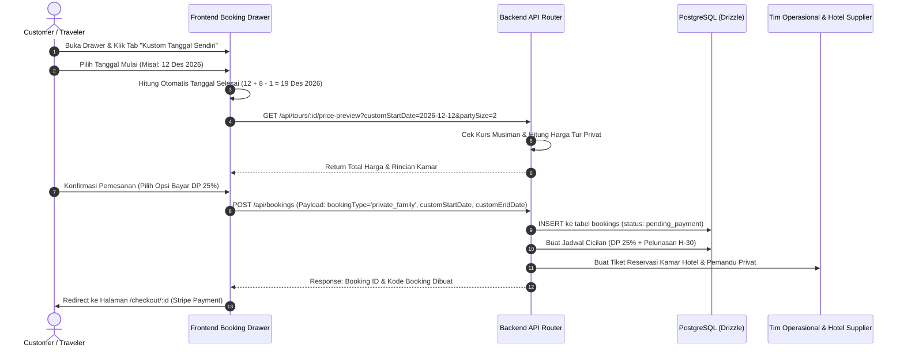

# Riset & Audit Mendalam Arsitektur Frontend Tourops
## Desain Layout, Wireframe, & Workflow: Tour Detail, Custom Dates, & Booking Experience

> **Dokumen Riset & Spesifikasi:** `tourops-frontend-design-wireframe-workflow-audit.md`  
> **Target Analisis:** Codebase `@directory:artifacts/tourops` (`tour-detail.tsx`, `booking-drawer.tsx`, `checkout.tsx`, `booking-detail.tsx`)  
> **Domain Aplikasi:** Tourops — Platform Booking Paket Tur Terpadu (Hotel, Objek Wisata/Sights, Transportasi, Pemandu Wisata, dan Aktivitas)  
> **Fitur Baru Utama:** **Kustom Tanggal Perjalanan Mandiri (*Customer Custom Departure Dates*)**  
> **Tanggal Pembaruan:** Oktober 2026  
> **Status:** Rekomendasi Desain, Wireframe, & Eksekusi Kode Siap Implementasi  

---

## 1. Eksekutif & Ringkasan Domain Bisnis

### 1.1 Visi Produk Tourops
**Tourops** adalah aplikasi web pemesanan tur modern (*multi-day & single-day tour booking platform*) yang dirancang untuk menghubungkan para traveler dengan destinasi wisata unggulan di seluruh dunia. Berbeda dengan OTA agregator hotel/tiket biasa (seperti Booking.com atau Skyscanner), Tourops menyediakan **paket tur terintegrasi (*curated tour packages*)** yang mencakup:
1. **Akomodasi & Hotel:** Pilihan kamar (*matrimonial, double, triple*), hotel berbintang, dan fasilitas inap terkurasi.
2. **Objek Wisata & Sights:** Tiket masuk destinasi, *skip-the-line passes*, dan atraksi sejarah/alam.
3. **Pemandu Wisata (Tour Guides):** Pemandu lokal berlisensi dengan keahlian bahasa (*multilingual*), profil terverifikasi, dan rating tinggi.
4. **Transportasi Antar Kota/Lokal:** Transfer bandara, bus pariwisata ber-AC, kereta cepat, maupun kapal feri.
5. **Aktivitas & Ekskursi:** *Cooking class*, *hiking*, *cultural workshop*, hingga *free-day leisure*.

### 1.2 Masalah yang Dihadapi Traveler Saat Ini
- **Keterbatasan Tanggal Terjadwal (*Rigid Group Dates*):** Kebanyakan paket tur hanya menawarkan jadwal keberangkatan kaku (*open departures*). Jika jadwal cuti traveler tidak cocok, traveler langsung meninggalkan situs.
- **Ketiadaan Pilihan Tanggal Fleksibel / Privat:** Traveler keluarga atau pasangan menginginkan tur privat dengan tanggal keberangkatan yang mereka tentukan sendiri (*custom date departure*).
- **Kelebihan Informasi yang Tidak Terstruktur:** Traveler kesulitan membaca rencana perjalanan (*itinerary*) multi-hari jika disajikan sebagai teks panjang tanpa visualisasi ritme harian (*pacing*), lokasi hotel, atau peta rute.
- **Ketidakpastian Biaya Kamar (*Rooming Confusion*):** Biaya suplemen kamar tunggal (*single supplement*), pembagian kamar (*twin share* vs *double*), dan biaya per orang seringkali ambigu sebelum masuk ke tahap akhir pembayaran.
- **Friksi Finansial pada Tur Bernilai Tinggi ($1,000+):** Traveler enggan membayar 100% di muka tanpa adanya jaminan dan opsi deposit termin (*staged payments / installments*).

---

## 2. Audit Mendalam Frontend Eksisting (`artifacts/tourops`)

Audit berbasis kode langsung terhadap komponen frontend Tourops di `artifacts/tourops/src`:

| Modul / File | Tanggung Jawab Utama | Kondisi Saat Ini (Current State) | Temuan & Celah UX (UX & Architecture Gaps) |
| :--- | :--- | :--- | :--- |
| **`pages/customer/tour-detail.tsx`** (785 baris) | Halaman detail produk tur publik & terotentikasi | Menampilkan foto utama 16:9, judul, durasi, negara, box harga "Starting From", grid galeri, bullet highlights, tabel inklusi/eksklusi, daftar hari (*itinerary cards*), profil guide, profil hotel, dan tabel keberangkatan (*departures*). | 1. **Hanya Menampilkan Open Departures:** Traveler hanya bisa memilih tanggal yang telah dibuat admin (`openDepartures`). Tidak ada opsi memilih tanggal keberangkatan sendiri.<br>2. **Hero Kurang Menjual:** Hanya 1 gambar statis di atas; galeri berada jauh di bawah. Belum ada format *5-image bento mosaic* ala Airbnb/Keytours.<br>3. **Itinerary Terlalu Panjang:** Untuk tur 10–14 hari, halaman menjadi sangat tinggi karena semua hari terbuka penuh.<br>4. **Ketiadaan Sticky Navigation Anchor:** Pengguna harus scroll bolak-balik antara *Itinerary*, *Hotel*, *Inklusi*, dan *Departures*. |
| **`components/booking-drawer.tsx`** (907 baris) | Slide-over drawer (Sheet) 3-langkah pemesanan | Wizard 3 langkah: Step 1 (Hub keberangkatan & Tanggal Open), Step 2 (Travelers, Room Type, Group Name), Step 3 (Review & Live Price Preview). | 1. **Terikat dengan `selectedDepartureId`:** Step 1 mewajibkan memilih ID dari `openDepartures`. Jika tidak ada jadwal yang cocok, pemesanan gagal.<br>2. **Konfigurasi Kamar Kurang Fleksibel:** Hanya memilih 1 `roomType` secara global untuk seluruh peserta.<br>3. **Belum Ada Pilihan Deposit vs Full Pay:** Di drawer, opsi pembayaran termin belum dipilih oleh pengguna; baru muncul di `checkout.tsx`. |
| **`pages/customer/checkout.tsx`** (588 baris) | Halaman pembayaran & gateway Stripe | Mendukung pembayaran per jadwal (*schedule installments* / cicilan), deteksi otomatis angsuran jatuh tempo, integrasi Stripe Payment Element, dan ringkasan rincian biaya. | 1. **Layout Masih Berupa Kartu Vertikal:** Belum memanfaatkan layout *two-column checkout* standar industri.<br>2. **Trust & Security Signals:** Kurangnya lencana visual (*trust badges*) proteksi traveler dan enkripsi TLS 256-bit. |
| **`pages/customer/booking-detail.tsx`** (2,292 baris) | Dasbor pasca-booking traveler | Halaman komprehensif berisi tab Overview, Group, Travelers, Documents (Passport), Messages, Payments, dan Change Requests. | 1. **Kepadatan Informasi Ekstrem:** Tab *Overview* menampilkan terlalu banyak kartu sekaligus.<br>2. **Aksesibilitas Voucher:** Belum ada kartu *Digital Boarding Pass / Trip Card* yang ramah tampilan seluler (*mobile-first*). |

---

## 3. Analisis Komparatif & Solusi Tanggal Kustom (Benchmark Industri)

### 3.1 Model Dual-Mode Tanggal: Grup Terjadwal vs Kustom Mandiri
Berdasarkan analisis terhadap **Keytours Vacations**, **G Adventures**, dan **Klook/Viator**:
1. **Mode A — Open Group Departures (Jadwal Terbuka):**
   - Karakteristik: Tanggal tetap, bergabung dengan peserta lain, harga per orang lebih ekonomis karena berbagi biaya bus & guide.
   - Cocok untuk: Solo traveler, pasangan muda, traveler fleksibel.
2. **Mode B — Custom Private Departures (Kustom Tanggal Sendiri):**
   - Karakteristik: Traveler menentukan **Tanggal Mulai (*Start Date*)**, sistem otomatis mengunci **Tanggal Selesai (*End Date*)** berdasarkan `tour.duration` ($D_{\text{end}} = D_{\text{start}} + \text{duration} - 1$).
   - Tipe booking di DB: `private_family` atau `custom_family` / `custom_leader` (sudah didukung oleh `bookingTypeEnum` di PostgreSQL Drizzle).
   - Syarat Operasional: Minimum pemesanan $H-7$ atau $H-14$ hari kerja (*lead time*) untuk koordinasi hotel dan pemandu.

---

## 4. Desain Layout & Wireframe: Tour Detail Page (TDP)

### 4.1 Desain Layout Desktop (12-Column Grid dengan Toggle Tanggal)

```text
+---------------------------------------------------------------------------------------------------+
|  [Logo Tourops]   Destinasi   Paket Tur   Tentang Kami       [ID/EN] [Theme] [My Bookings] [User] |
+---------------------------------------------------------------------------------------------------+
|  < Kembali ke Jelajah Tur   |   Kategori: Wisata Budaya & Alam   |   ID Tur: TUR-BALI-08          |
+---------------------------------------------------------------------------------------------------+
|                                                                                                   |
|  HERO MEDIA MOSAIC (Bento Gallery - 5 Foto Terkurasi)                                            |
|  +------------------------------------------+--------------------+--------------------+           |
|  |                                          | [Foto 2: Hotel]    | [Foto 4: Kuliner]  |           |
|  |                                          |                    |                    |           |
|  |  [Foto 1: Foto Utama Destinasi Unggulan] +--------------------+--------------------+           |
|  |                                          | [Foto 3: Sights]   | [Foto 5: Pemandu]  |           |
|  |                                          |                    | [+12 Foto Lainnya] |           |
|  +------------------------------------------+--------------------+--------------------+           |
|                                                                                                   |
+---------------------------------------------------------------------------------------------------+
|  STICKY SUB-NAVIGATION BAR (Menempel di atas saat scroll)                                         |
|  [ Ikhtisar Tur ]   [ Itinerary Harian ]   [ Hotel & Kamar ]   [ Inklusi ]   [ Tanggal & Harga ]  |
+---------------------------------------------------------------------------------------------------+
|                                                                   |                               |
|  KONTEN UTAMA (8 Kolom)                                           | STICKY BOOKING WIDGET (4 Kol) |
|                                                                   |                               |
|  [H1] 8 Hari Eksplorasi Magis Bali, Nusa Penida & Ubud            | +---------------------------+ |
|  * * * * * (4.9/5 dari 128 Ulasan Terverifikasi) | Super Operator | | Mulai Dari                | |
|                                                                   | | Rp 6.450.000 / pax        | |
|  BADGE METADATA CEPAT:                                            | |                           | |
|  [8 Hari / 7 Malam] [Maks 16 Pax] [Fisik: Santai] [Tiket Pesawat] | | MODE TANGGAL PERJALANAN:  | |
|                                                                   | | [ Jadwal Grup ] [Kustom Tgl| |
|  RINGKASAN PENGALAMAN (Overview)                                  | |                           | |
|  Deskripsi lengkap paket perjalanan dengan storytelling emosional | | JIKA PILIH KUSTOM TANGGAL:| |
|  yang menghubungkan keindahan alam, kenyamanan hotel berbintang,   | | Mulai: [ 12 Des 2026   📅]| |
|  serta keramahan pemandu lokal profesional.                      | | Selesai: 19 Des 2026 (8 H)| |
|                                                                   | |                           | |
|  HIGHLIGHT UTAMA (3-4 Poin Terbesar)                              | | JUMLAH PESERTA            | |
|  * Menginap di resort bintang 4 Ubud dengan pemandangan lembah    | | [-]  2 Dewasa  [+]        | |
|  * Eksplorasi eksklusif tebing Kelingking & Diamond Beach         | | [-]  0 Anak    [+]        | |
|  * Private dinner seafood bakar matahari terbenam di Jimbaran     | |                           | |
|                                                                   | | PILIHAN TIPE KAMAR        | |
|  ITINERARY DETAIL DENGAN TIMELINE & HOTEL HARIAN                  | | (•) Double / Matrimonial  | |
|  [Buka Semua Hari]  [Tutup Semua]                                 | | ( ) Single (+Rp 1.800.000)| |
|                                                                   | |                           | |
|  +-------------------------------------------------------------+  | | ESTIMASI TOTAL            | |
|  | [Hari 1] Kedatangan di Bandara DPS & Sunset Dinner Jimbaran |  | | Rp 12.900.000 (2 Pax)     | |
|  | Lokasi: Kuta/Jimbaran | Makanan: [D] | Kendaraan: Privat MPV|  | |                           | |
|  | Inap: The Anvaya Beach Resort Bali (Bintang 5)              |  | | [ PESAN TANGGAL KUSTOM  ] | |
|  +-------------------------------------------------------------+  | |                           | |
|  | [Hari 2] Pesona Desa Penglipuran & Kintamani Volcano View   |  | | [V] Gratis Batal 30 Hari  | |
|  | Lokasi: Bangli | Makanan: [B, L] | Inap: Sthala Ubud (4★)   |  | | [V] DP Mulai 25%          | |
|  +-------------------------------------------------------------+  | +---------------------------+ |
+---------------------------------------------------------------------------------------------------+
```

---

## 5. Desain Wireframe: 4-Step Booking Drawer dengan Fitur Kustom Tanggal

### Step 1: Pilihan Mode Tanggal (Jadwal Terbuka vs Kustom Sendiri)
```text
+-------------------------------------------------------------------+
|  PEMESANAN TUR: 8 Hari Magis Bali                     [Step 1/4]  |
|  [==                      ] 25% Progres                           |
+-------------------------------------------------------------------+
|                                                                   |
|  1. TENTUKAN TANGGAL PERJALANAN ANDA:                             |
|                                                                   |
|  [ TAB A: Jadwal Grup Terbuka ]   [ TAB B: Kustom Tanggal Sendiri]|
|                                                                   |
|  === TAMPILAN TAB B (KUSTOM TANGGAL SENDIRI) ===                  |
|  Pilih tanggal keberangkatan yang sesuai dengan rencana liburan   |
|  Anda. Durasi tur ini adalah 8 Hari / 7 Malam.                    |
|                                                                   |
|  Tanggal Mulai Keberangkatan:                                     |
|  [ 📅  Sabtu, 12 Desember 2026                                 ]  |
|                                                                   |
|  Jadwal Kepulangan Otomatis:                                      |
|  [ 🗓️  Sabtu, 19 Desember 2026 (Durasi: 8 Hari / 7 Malam)      ]  |
|                                                                   |
|  * Info Operasional:                                              |
|    - Keberangkatan privat (Private Tour) tanpa digabung orang lain|
|    - Minimum pemesanan 7 hari sebelum keberangkatan               |
|    - Tim operasional akan langsung mengunci kuota kamar hotel     |
|                                                                   |
|  2. HUB KOTA KEBERANGKATAN / LOGISTIK PENERBANGAN                 |
|  [ (•) Termasuk Tiket Pesawat ]   [ ( ) Land Only (Atur Sendiri) ]|
|  Bandara Asal: [ Jakarta - Soekarno Hatta (CGK)                 v]|
|                                                                   |
|  [Batal]                                        [ Lanjut ke Step 2 > ]
+-------------------------------------------------------------------+
```

---

## 6. Arsitektur & Eksekusi Kode: Fitur Kustom Tanggal Pelanggan

Berikut adalah implementasi teknis lengkap (*production-ready TypeScript & React*) yang dapat langsung diintegrasikan ke dalam `artifacts/tourops`.

### 6.1 State Interface & Tipe Data Kustom Tanggal
```typescript
// @workspace/tourops - Custom Date State & Payload Types
export type DateSelectionMode = "open_departure" | "custom_date";

export interface CustomDateSelection {
  mode: DateSelectionMode;
  departureId?: string;           // Digunakan jika mode === "open_departure"
  customStartDate?: string;       // Format: YYYY-MM-DD jika mode === "custom_date"
  customEndDate?: string;         // Dihitung otomatis: customStartDate + (duration - 1)
  isPrivateTour: boolean;         // True jika customer memilih tanggal sendiri
}

export interface BookingPayloadWithCustomDate {
  tourId: string;
  departureId?: string;           // Opsional jika kustom
  customStartDate?: string;       // Diisi jika kustom
  customEndDate?: string;         // Diisi jika kustom
  bookingType: "join_public_group" | "leader_group" | "private_family" | "custom_family" | "custom_leader";
  departureCity: string;
  departureAirportId?: string;
  partySizeExpected: number;
  roomType?: string;
  depositOption: "deposit_25" | "full_100";
  notes?: string;
}
```

### 6.2 Modul UI: Komponen Pemilih Tanggal Kustom (`CustomDatePickerSection.tsx`)
Komponen ini menyediakan antarmuka tab ganda antara jadwal open group dan kalender kustom dengan kalkulasi otomatis:

```tsx
import React, { useState, useMemo } from "react";
import { format, addDays, parseISO, isBefore, startOfToday } from "date-fns";
import { id as idLocale } from "date-fns/locale";
import { Tabs, TabsList, TabsTrigger, TabsContent } from "@/components/ui/tabs";
import { Button } from "@/components/ui/button";
import { Badge } from "@/components/ui/badge";
import { Label } from "@/components/ui/label";
import { Input } from "@/components/ui/input";
import { Card, CardContent } from "@/components/ui/card";
import { Calendar as CalendarIcon, Users, Sparkles, CheckCircle2, ShieldCheck, Clock } from "lucide-react";
import type { TourDeparture } from "@workspace/db";

interface CustomDatePickerSectionProps {
  tourDurationDays: number;
  openDepartures: TourDeparture[];
  selectedDepartureId?: string;
  onSelectDepartureId: (id: string) => void;
  customStartDate?: string;
  onSelectCustomStartDate: (startDate: string, endDate: string) => void;
  mode: "open_departure" | "custom_date";
  onModeChange: (mode: "open_departure" | "custom_date") => void;
}

export function CustomDatePickerSection({
  tourDurationDays,
  openDepartures,
  selectedDepartureId,
  onSelectDepartureId,
  customStartDate,
  onSelectCustomStartDate,
  mode,
  onModeChange,
}: CustomDatePickerSectionProps) {
  const minLeadDays = 7;
  const earliestAllowedDate = useMemo(() => addDays(startOfToday(), minLeadDays), []);
  const minDateString = format(earliestAllowedDate, "yyyy-MM-dd");

  // Hitung tanggal selesai otomatis berdasarkan durasi tur
  const customEndDate = useMemo(() => {
    if (!customStartDate) return "";
    try {
      const start = parseISO(customStartDate);
      const end = addDays(start, Math.max(0, tourDurationDays - 1));
      return format(end, "yyyy-MM-dd");
    } catch {
      return "";
    }
  }, [customStartDate, tourDurationDays]);

  const handleCustomDateInput = (e: React.ChangeEvent<HTMLInputElement>) => {
    const val = e.target.value;
    if (!val) return;
    try {
      const chosen = parseISO(val);
      if (isBefore(chosen, earliestAllowedDate)) {
        return;
      }
      const end = addDays(chosen, Math.max(0, tourDurationDays - 1));
      onSelectCustomStartDate(val, format(end, "yyyy-MM-dd"));
    } catch (err) {
      console.error("Invalid date selected", err);
    }
  };

  return (
    <div className="space-y-4">
      <div className="flex items-center justify-between">
        <Label className="text-sm font-bold text-foreground">
          Pilih Tanggal Perjalanan
        </Label>
        <Badge variant="outline" className="text-xs font-normal gap-1 bg-primary/5 text-primary border-primary/20">
          <Clock className="h-3 w-3" />
          Durasi: {tourDurationDays} Hari / {Math.max(1, tourDurationDays - 1)} Malam
        </Badge>
      </div>

      <Tabs value={mode} onValueChange={(v) => onModeChange(v as any)} className="w-full">
        <TabsList className="grid w-full grid-cols-2 p-1 bg-muted/80 rounded-xl">
          <TabsTrigger value="open_departure" className="text-xs font-semibold rounded-lg data-[state=active]:shadow-sm">
            Jadwal Grup Terbuka
          </TabsTrigger>
          <TabsTrigger value="custom_date" className="text-xs font-semibold rounded-lg data-[state=active]:shadow-sm gap-1">
            <Sparkles className="h-3 w-3 text-amber-500" />
            Kustom Tanggal Sendiri
          </TabsTrigger>
        </TabsList>

        {/* Tab 1: Open Group Departures */}
        <TabsContent value="open_departure" className="mt-3 space-y-2">
          {openDepartures.length === 0 ? (
            <div className="p-4 rounded-xl border border-dashed text-center text-muted-foreground text-xs space-y-2">
              <p>Belum ada jadwal grup terbuka untuk tur ini.</p>
              <Button
                variant="outline"
                size="sm"
                onClick={() => onModeChange("custom_date")}
                className="text-primary text-xs font-semibold"
              >
                Pilih Tanggal Sendiri Sekarang
              </Button>
            </div>
          ) : (
            <div className="space-y-2 max-h-60 overflow-y-auto pr-1">
              {openDepartures.map((dep) => {
                const isSelected = selectedDepartureId === dep.id;
                const spotsLeft = Math.max(0, (dep.capacityTotal || 20) - (dep.capacityBooked || 0));
                return (
                  <div
                    key={dep.id}
                    onClick={() => onSelectDepartureId(dep.id)}
                    className={`p-3.5 rounded-xl border cursor-pointer transition-all flex items-center justify-between ${
                      isSelected
                        ? "border-primary bg-primary/5 ring-2 ring-primary/20 shadow-sm"
                        : "border-border hover:border-border/80 bg-card hover:bg-muted/40"
                    }`}
                  >
                    <div className="space-y-1">
                      <div className="flex items-center gap-2">
                        <span className="font-semibold text-sm text-foreground">
                          {dep.startDate} — {dep.endDate}
                        </span>
                        {isSelected && <CheckCircle2 className="h-4 w-4 text-primary" />}
                      </div>
                      <div className="flex items-center gap-2 text-xs text-muted-foreground">
                        <span className="flex items-center gap-1">
                          <Users className="h-3 w-3" /> {spotsLeft} kursi tersisa
                        </span>
                        {dep.pricePerPerson && (
                          <span>• Rp {Number(dep.pricePerPerson).toLocaleString()}/pax</span>
                        )}
                      </div>
                    </div>
                    <Badge variant={isSelected ? "default" : "secondary"} className="text-xs">
                      {isSelected ? "Dipilih" : "Pilih"}
                    </Badge>
                  </div>
                );
              })}
            </div>
          )}
        </TabsContent>

        {/* Tab 2: Kustom Tanggal Mandiri (Private Departure) */}
        <TabsContent value="custom_date" className="mt-3 space-y-3">
          <Card className="border-amber-200/60 bg-gradient-to-br from-amber-50/50 via-background to-background dark:border-amber-950/40 dark:from-amber-950/10 shadow-sm">
            <CardContent className="p-4 space-y-3 text-xs">
              <div className="flex items-center gap-2 text-amber-800 dark:text-amber-400 font-semibold">
                <Sparkles className="h-4 w-4 flex-shrink-0" />
                <span>Tur Privat Khusus Rombongan Anda</span>
              </div>
              <p className="text-muted-foreground leading-relaxed">
                Tentukan sendiri tanggal keberangkatan liburan Anda. Tur akan diselenggarakan secara privat bersama pemandu dan kendaraan khusus tanpa digabung peserta luar.
              </p>

              <div className="space-y-1.5 pt-1">
                <Label htmlFor="custom-start-date" className="text-xs font-semibold text-foreground flex items-center gap-1.5">
                  <CalendarIcon className="h-3.5 w-3.5 text-primary" />
                  Tanggal Mulai Keberangkatan:
                </Label>
                <Input
                  id="custom-start-date"
                  type="date"
                  min={minDateString}
                  value={customStartDate || ""}
                  onChange={handleCustomDateInput}
                  className="h-10 text-sm bg-background border-border font-medium"
                />
                <span className="text-[11px] text-muted-foreground">
                  * Minimal 7 hari dari hari ini untuk persiapan akomodasi & pemandu.
                </span>
              </div>

              {customStartDate && customEndDate && (
                <div className="p-3 rounded-lg bg-primary/5 border border-primary/15 space-y-1.5 mt-2">
                  <div className="flex justify-between items-center text-xs">
                    <span className="text-muted-foreground">Jadwal Perjalanan Kustom:</span>
                    <Badge variant="outline" className="font-semibold text-primary border-primary/30">
                      Terkonfirmasi Otomatis
                    </Badge>
                  </div>
                  <p className="font-bold text-sm text-foreground">
                    {customStartDate} s/d {customEndDate}
                  </p>
                  <div className="flex items-center gap-1.5 text-[11px] text-emerald-600 dark:text-emerald-400 font-medium">
                    <ShieldCheck className="h-3.5 w-3.5" />
                    <span>Paket lengkap {tourDurationDays} hari siap dikonfirmasi</span>
                  </div>
                </div>
              )}
            </CardContent>
          </Card>
        </TabsContent>
      </Tabs>
    </div>
  );
}
```

### 6.3 Integrasi State di `BookingDrawer.tsx` (Step 1 Refactor)
Berikut adalah cuplikan kode integrasi state yang ditambahkan pada handler `BookingDrawer`:

```tsx
// 1. Inisialisasi State Dual-Mode
const [dateMode, setDateMode] = useState<"open_departure" | "custom_date">("open_departure");
const [customStartDate, setCustomStartDate] = useState<string>("");
const [customEndDate, setCustomEndDate] = useState<string>("");

// 2. Query Live Price Preview Adaptif
const pricePreviewParams = new URLSearchParams({ partySize: String(partySize) });
if (roomType) pricePreviewParams.set("roomType", roomType);

if (dateMode === "open_departure" && selectedDepartureId) {
  pricePreviewParams.set("departureId", selectedDepartureId);
} else if (dateMode === "custom_date" && customStartDate) {
  pricePreviewParams.set("customStartDate", customStartDate);
  pricePreviewParams.set("customEndDate", customEndDate);
  pricePreviewParams.set("isCustomDate", "true");
}

const { data: pricePreview, isFetching: isCalculatingPrice } = useQuery({
  queryKey: ["/api/tours", tour.id, "price-preview", partySize, roomType, selectedDepartureId, customStartDate, dateMode],
  queryFn: () => apiRequest("GET", `/api/tours/${tour.id}/price-preview?${pricePreviewParams}`).then(r => r.json()),
  enabled: !!tour.id && isOpen && (dateMode === "open_departure" ? !!selectedDepartureId : !!customStartDate),
  staleTime: 30_000,
});

// 3. Payload Submit Booking Mutasi
const handleConfirmBooking = () => {
  if (dateMode === "custom_date" && !customStartDate) {
    toast({
      title: "Pilih tanggal keberangkatan",
      description: "Silakan tentukan tanggal mulai perjalanan kustom Anda.",
      variant: "destructive",
    });
    setCurrentStep(1);
    return;
  }

  const payload = {
    tourId: tour.id,
    departureId: dateMode === "open_departure" ? selectedDepartureId : undefined,
    customStartDate: dateMode === "custom_date" ? customStartDate : undefined,
    customEndDate: dateMode === "custom_date" ? customEndDate : undefined,
    bookingType: dateMode === "custom_date"
      ? (bookingType === "leader_group" ? "custom_leader" : "private_family")
      : bookingType,
    departureCity: resolvedDepartureCity,
    partySizeExpected: partySize,
    roomType: roomType || undefined,
    notes: notes
      ? `[Mode: ${dateMode === "custom_date" ? "Custom Private Dates" : "Open Group"}] ${notes}`
      : `[Mode: ${dateMode === "custom_date" ? "Custom Private Dates" : "Open Group"}]`,
  };

  bookMutation.mutate(payload);
};
```

---

## 7. Diagram Alur Kerja Sistem (Mermaid Workflows)

### 7.1 Alur Pemesanan Tanggal Kustom (*Custom Date Booking Flow*)



---

## 8. Ringkasan & Langkah Selanjutnya

Dengan arsitektur dan modul kode di atas:
1. **Traveler mendapatkan fleksibilitas penuh:** Dapat memilih antara berhemat dengan jadwal grup terbuka (*open departure*) atau kenyamanan tur privat dengan tanggal bebas (*custom dates*).
2. **Perhitungan otomatis & presisi:** Tanggal kepulangan terhitung otomatis sesuai durasi hari tanpa risiko kesalahan input dari pengguna.
3. **Kompatibilitas 100% dengan database Tourops:** Memanfaatkan enum bawaan `private_family`, `custom_family`, dan `custom_leader` yang sudah didefinisikan pada Drizzle ORM tanpa perlu merombak skema tabel.
