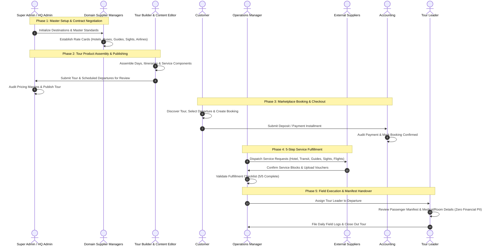

# TourOps Role Permissions & Capabilities Guide

> **Document Version:** 1.0.0  
> **Audience:** Product Owners, Developers, QA Engineers, Security Auditors, and Operations Personnel  
> **System Scope:** TourOps Travel & Tour Operations Management Platform

---

## 1. Executive Overview & System Architecture

TourOps operates on an enterprise **Role-Based Access Control (RBAC)** architecture designed for multi-tier travel management. The platform separates responsibilities across **17 distinct roles** organized into functional domains:

```
                               ┌──────────────────────────────────────────────┐
                               │                 Super Admin                  │
                               │             (Full System Control)            │
                               └──────────────────────┬───────────────────────┘
                                                      │
         ┌────────────────────────────────────────────┼────────────────────────────────────────────┐
         │                                            │                                            │
┌────────┴─────────┐                       ┌──────────┴──────────┐                      ┌──────────┴──────────┐
│  Administration  │                       │ Operations & Trip   │                      │  Suppliers & Rates  │
│  & Destination   │                       │     Execution       │                      │      (Catalogs)     │
├──────────────────┤                       ├─────────────────────┤                      ├─────────────────────┤
│ • HQ Admin       │                       │ • Operations Mgr    │                      │ • Hotel Manager     │
│ • Country Mgr    │                       │ • Tour Leader       │                      │ • Transport Manager │
│ • City Manager   │                       │ • Flight Agent      │                      │ • Guide Manager     │
│ • Tour Builder   │                       │ • Support Agent     │                      │ • Sights Manager    │
│ • Content Editor │                       │ • Accounting        │                      │ • Airline Supplier  │
│                  │                       │                     │                      │ • General Supplier  │
└──────────────────┘                       └─────────────────────┘                      └─────────────────────┘
                                                      │
                                           ┌──────────┴──────────┐
                                           │      Customer       │
                                           │  (Public Discovery) │
                                           └─────────────────────┘
```

### 1.1 Dedicated Login Portals

Access is strictly segmented at the gateway level across three access entry points:

| Portal Type | Route URL | Allowed Roles |
|:---|:---|:---|
| **Super Admin Portal** | `/admin/login` | `super_admin`, `admin` |
| **Staff & Supplier Portal** | `/staff/login` | `operations_manager`, `accounting`, `tour_leader`, `support_agent`, `tour_builder`, `content_editor`, `flight_agent`, `country_manager`, `city_manager`, `hotel_manager`, `transport_manager`, `guide_manager`, `sights_manager`, `airline_supplier`, `supplier` |
| **Customer Portal** | `/login` (Public Web) | `customer` |

---

## 2. Core Security & Access Boundaries

1. **Strict Financial Privacy Isolation (Tour Leader Wall):**
   - Field personnel (`tour_leader`) can inspect passenger manifests, medical/dietary requirements, room arrangements, and emergency contacts.
   - They are **strictly blocked** from seeing company profit margins, markup rates, supplier net costs, and customer payment details.
2. **Multi-Tenant Supplier Isolation:**
   - External vendors (`supplier`, `airline_supplier`, `hotel_manager`, etc.) only see service fulfillment requests specifically assigned to them.
   - Cross-supplier rates, internal margin calculations, and general customer profiles are completely inaccessible.
3. **Customer Insecure Direct Object Reference (IDOR) Protection:**
   - Customers (`customer`) are scoped to their own row records (`customerId === req.session.userId` or matching join code).
   - Attempting to query or modify another traveler's booking returns HTTP `403 Forbidden` / `404 Not Found`.
4. **Segregation of Duties (SoD):**
   - Content editors cannot alter pricing or schedule departures.
   - Tour builders cannot publish live tours without Admin approval.
   - Support agents cannot initiate financial refunds or reconcile ledger items.
   - Accounting cannot dispatch operational field resources or alter itineraries.

---

## 3. Comprehensive Role-by-Role Capabilities

---

### 3.1 Executive & Core Administration

#### 1. Super Admin (`super_admin`)
- **Portal & Landing:** `/admin/login` &rarr; `/admin`
- **Default Test Account:** `superadmin1` / `password123`
- **Purpose:** Full administrative authority over all application entities, infrastructure, and security settings.
- **What They CAN Do:**
  - Full CRUD on user accounts (`/api/admin/users`), including password resets, role reassignment, and profile activation.
  - Manage all master data globally: countries, cities, airports, currencies, and exchange rates.
  - Review, approve, publish, and delete tour packages and departure dates.
  - Configure global pricing engine rules, seasonal markups, and company margin policies.
  - Execute test data resets and database re-seeding utilities (`/admin/test-data`).
  - Access enterprise financial ledgers, audit trails, and payment overrides.
- **What They CANNOT Do:**
  - *No system restrictions.* Holds unrestricted platform-wide privileges.

#### 2. HQ Admin (`admin`)
- **Portal & Landing:** `/admin/login` &rarr; `/admin`
- **Default Test Account:** `admin1` / `password123`
- **Purpose:** Daily business operations management and tour program governance.
- **What They CAN Do:**
  - Approve drafted hotels, tour packages, and published departures.
  - Assign operational tasks to operations managers and staff.
  - Access system-wide bookings, customer itineraries, and passenger manifests.
  - Review financial transactions, invoices, and sales reports.
- **What They CANNOT Do:**
  - Cannot execute destructive test data wipes or developer seed scripts reserved exclusively for `super_admin`.
  - Cannot alter root environment configurations.

---

### 3.2 Product Development & Content Design

#### 3. Tour Package Builder (`tour_builder`)
- **Portal & Landing:** `/staff/login` &rarr; `/ops/tour-builder`
- **Default Test Account:** `tourbuilder1` / `password123`
- **Purpose:** Architects tour products, daily itineraries, and component service requirements.
- **What They CAN Do:**
  - Create new tour definitions, duration structures, and theme classifications.
  - Build day-by-day itineraries (`/api/tour-days`) and attach service components (accommodations, transfers, sightseeing, guide slots).
  - Define departure dates and group capacity limits.
  - Calculate raw component cost estimates.
- **What They CANNOT Do:**
  - **Cannot publish tours** directly to the public marketplace (requires Admin review/approval).
  - **Cannot view customer PII** or manage live customer bookings.
  - **Cannot record or reconcile payments**.

#### 4. Content & Media Editor (`content_editor`)
- **Portal & Landing:** `/staff/login` &rarr; `/ops/content-editor`
- **Default Test Account:** `contenteditor1` / `password123`
- **Purpose:** Brand storytelling, marketing descriptions, media assets, and multilingual localizations.
- **What They CAN Do:**
  - Edit tour marketing titles, promotional summaries, and detailed descriptions.
  - Upload, organize, and tag tour image galleries and media assets.
  - Manage translations across supported languages (English, Spanish, Indonesian).
- **What They CANNOT Do:**
  - **Cannot change tour pricing, departures, or margins**.
  - **Cannot modify day-by-day itinerary structures** or remove operational services.
  - **Cannot access customer bookings, financial records, or operational dispatches**.

---

### 3.3 Destination & Regional Governance

#### 5. Country Regional Manager (`country_manager`)
- **Portal & Landing:** `/staff/login` &rarr; `/ops`
- **Default Test Account:** `countrymanager1` / `password123`
- **Purpose:** Oversees tour operations, supplier relations, and master data within a designated country territory.
- **What They CAN Do:**
  - Manage national master records: registered domestic cities, destination highlights, and domestic airports.
  - Oversee all supplier catalogs and rate agreements operating within their assigned country.
  - View bookings and traveler volumes arriving in or departing from their country.
- **What They CANNOT Do:**
  - **Cannot view or edit master records outside their assigned country**.
  - **Cannot alter global platform pricing formulas** or platform margin policies.
  - **Cannot execute global user administration**.

#### 6. City Destination Manager (`city_manager`)
- **Portal & Landing:** `/staff/login` &rarr; `/ops/city-manager`
- **Default Test Account:** `citymanager1` / `password123`
- **Purpose:** Hyper-local destination curator managing sights, activities, and local hotel relationships.
- **What They CAN Do:**
  - Maintain points of interest (POI), local monuments, and city sights catalogs.
  - Link local hotels and attractions to city profiles.
  - Report local disruption events (e.g., road closures, local holidays) impacting tour routes.
- **What They CANNOT Do:**
  - **Cannot view global bookings or customer databases**.
  - **Cannot manage airline rates or cross-country transport contracts**.
  - **Cannot access company financial ledgers or accounting tools**.

---

### 3.4 Domain Supplier & Catalog Specialists

#### 7. Hotel & Lodging Manager (`hotel_manager`)
- **Portal & Landing:** `/staff/login` &rarr; `/supplier` (Hotel Tab)
- **Default Test Account:** `hotelmanager1` / `password123`
- **Purpose:** Manages hotel properties, room categories, seasonal rate cards, and accommodation fulfillment.
- **What They CAN Do:**
  - Register new hotels and lodging profiles (submitted in *Draft* status pending Admin verification).
  - Configure room configurations: *Matrimonial (Double/King)*, *Double (Twin)*, and *Triple*.
  - Maintain seasonal rate contracts, blackout dates, and meal plan supplements (Bed & Breakfast, Half Board, All Inclusive).
  - Confirm or reject hotel reservation requests dispatched by Operations.
- **What They CANNOT Do:**
  - **Cannot view competitor hotel contracts or rate cards**.
  - **Cannot access flight, guide, or transport catalogs**.
  - **Cannot view customer billing data or trip profit margins**.

#### 8. Transportation Manager (`transport_manager`)
- **Portal & Landing:** `/staff/login` &rarr; `/ops/transport`
- **Default Test Account:** `transportmanager1` / `password123`
- **Purpose:** Manages vehicle fleets, bus charters, transfer routes, and ground transit logistics.
- **What They CAN Do:**
  - Register transport partner companies, bus categories, and seating capacities (e.g., Minivan, Medium Coach, 50-Seat Bus).
  - Configure point-to-point transfer routes and kilometer/daily charter tariffs.
  - Receive, dispatch, and confirm transport booking requests.
  - Issue and verify transport service invoices (`/api/transport-invoices`).
- **What They CANNOT Do:**
  - **Cannot alter hotel rate cards or attraction ticket rates**.
  - **Cannot modify general tour itineraries**.
  - **Cannot read customer payment instruments or credit balances**.

#### 9. Tour Guide Coordinator (`guide_manager`)
- **Portal & Landing:** `/staff/login` &rarr; `/supplier` (Tab: Guide Rates)
- **Default Test Account:** `guidemanager1` / `password123`
- **Purpose:** Manages local licensed tour guides, language proficiencies, and daily honorarium rates.
- **What They CAN Do:**
  - Maintain guide rosters, certified language proficiencies (English, German, French, Mandarin, etc.), and local licenses.
  - Set half-day, full-day, and overtime rate agreements.
  - Review and confirm guide availability requests dispatched by the Operations team.
- **What They CANNOT Do:**
  - **Cannot access global booking registers or company financial audits**.
  - **Cannot view hotel pricing or transport charter contracts**.

#### 10. Sights & Attractions Manager (`sights_manager`)
- **Portal & Landing:** `/staff/login` &rarr; `/supplier` (Tab: Sights Catalog)
- **Default Test Account:** `sightsmanager1` / `password123`
- **Purpose:** Manages attraction admission tickets, monument reservations, and entry protocols.
- **What They CAN Do:**
  - Maintain attraction profiles, opening hours, visiting time slots, and admission regulations.
  - Set adult, child, and senior tariff tiers for monument entries.
  - Manage bulk entrance ticket reservations and group voucher confirmations.
- **What They CANNOT Do:**
  - **Cannot alter tour package retail prices**.
  - **Cannot access staff management or customer payment files**.

#### 11. Airline Supplier Partner (`airline_supplier`)
- **Portal & Landing:** `/staff/login` &rarr; `/supplier` (Tab: Airlines Catalog)
- **Default Test Account:** `airlinesupplier1` / `password123`
- **Purpose:** External airline vendor managing group allotments, flight segments, and airfare rate cards.
- **What They CAN Do:**
  - Maintain contracted airfare rates, flight routes, and seat inventory blocks.
  - Acknowledge and confirm airline group reservation requests.
  - Upload e-ticket manifests and flight change notices.
- **What They CANNOT Do:**
  - **Strictly isolated as an external partner:** Blocked from staff directories, hotel contracts, guide rates, and platform financial accounts.

#### 12. General Supplier Partner (`supplier`)
- **Portal & Landing:** `/staff/login` &rarr; `/supplier`
- **Default Test Account:** `supplier1` / `password123`
- **Purpose:** External third-party service provider (local experiential vendors, boat transfers, specialized excursions).
- **What They CAN Do:**
  - View service requests strictly assigned to their own vendor ID (`/api/supplier/requests`).
  - Accept, decline, or add operational notes to assigned requests.
  - Upload service confirmation vouchers and invoices.
- **What They CANNOT Do:**
  - **Tenant-isolated:** Cannot see requests belonging to any other vendor.
  - **Cannot view customer retail prices, package costs, or traveler contact info outside their operational window**.

---

### 3.5 Operations & Trip Execution

#### 13. Operations Manager (`operations_manager`)
- **Portal & Landing:** `/staff/login` &rarr; `/ops`
- **Default Test Account:** `operationsmanager1` / `password123`
- **Purpose:** Central mission control driving booking lifecycle transitions and service fulfillment.
- **What They CAN Do:**
  - Advance booking lifecycle statuses through validated operational stages (*Draft &rarr; Confirmed &rarr; Dispatched &rarr; In-Trip &rarr; Completed*).
  - Execute the **5-Step Service Fulfillment Workflow**:
    1. *Airline / Flight Allocation*
    2. *Hotel Room Block Request*
    3. *Transport & Coach Dispatch*
    4. *Licensed Guide Assignment*
    5. *Sightseeing Ticket Reservation*
  - Assign Tour Leaders and operational staff to departing groups (`/ops/assignments`).
  - Process custom group quotation requests and capacity adjustments.
- **What They CANNOT Do:**
  - **Cannot alter core accounting ledgers** or approve customer refunds.
  - **Cannot rewrite base product pricing formulas**.
  - **Cannot perform system administrator tasks** (e.g., reset user passwords).

#### 14. Flight Booking Specialist (`flight_agent`)
- **Portal & Landing:** `/staff/login` &rarr; `/ops/flight-agent`
- **Default Test Account:** `flightagent1` / `password123`
- **Purpose:** Coordinates airline bookings, ticket issuance, PNR tracking, and airport logistics.
- **What They CAN Do:**
  - Manage flight allotments, PNR (Passenger Name Record) entries, and e-ticket numbers.
  - Coordinate airport arrivals, transit transfers, and flight delay updates.
  - Interface with airline partners on group check-in and seat assignments.
- **What They CANNOT Do:**
  - **Cannot view or manage non-flight suppliers** (hotels, buses, guides).
  - **Cannot access general company accounting ledgers**.

#### 15. Tour Leader (`tour_leader`)
- **Portal & Landing:** `/staff/login` &rarr; `/ops/tour-leader` or `/leader-dashboard`
- **Default Test Account:** `tourleader1` / `password123`
- **Purpose:** On-the-ground trip escort responsible for passenger welfare and itinerary execution.
- **What They CAN Do:**
  - View assigned tour departures, daily schedules, and accommodation lists.
  - Access passenger manifests: full names, passport details, dietary requirements, room assignments, and emergency contacts.
  - Submit real-time field incident reports (`/api/incidents`) and operational notes.
  - Communicate with travelers and operational dispatch.
- **What They CANNOT Do:**
  - **FINANCIAL PRIVACY WALL:** Strict block on company profit margins, tour markup percentages, supplier purchase rates, and customer payment methods.
  - **Cannot modify booking contracts** or cancel customer reservations.

#### 16. Customer Support Agent (`support_agent`)
- **Portal & Landing:** `/staff/login` &rarr; `/ops/support`
- **Default Test Account:** `supportagent1` / `password123`
- **Purpose:** Assists customers with pre-trip inquiries, passport compliance, and booking modifications.
- **What They CAN Do:**
  - Read customer bookings and view itinerary details.
  - Verify traveler passport documentation (confirming validity > 6 months).
  - Handle customer messaging and ticket inquiries.
  - Escalate operational or financial issues to Operations and Accounting.
- **What They CANNOT Do:**
  - **Cannot execute financial transactions, refund credits, or alter invoice balances**.
  - **Cannot dispatch supplier resources or assign field guides**.

---

### 3.6 Finance & Financial Control

#### 17. Accounting & Finance (`accounting`)
- **Portal & Landing:** `/staff/login` &rarr; `/ops/accounting`
- **Default Test Account:** `accounting1` / `password123`
- **Purpose:** Manages financial integrity, accounts receivable/payable, installment tracking, and auditing.
- **What They CAN Do:**
  - Access the enterprise payment ledger (`/admin/payments`).
  - Record manual bank transfers, cash payments, and confirm pending customer installments.
  - Audit customer balance schedules, payment due dates, and overdue accounts.
  - Process authorized refunds, supplier invoice payouts, and affiliate commission disbursements.
- **What They CANNOT Do:**
  - **Cannot alter tour itinerary components** or change supplier assignments.
  - **Cannot reassign tour leaders or alter operational dispatch statuses**.

---

### 3.7 Customer & Consumer

#### 18. Customer (`customer`)
- **Portal & Landing:** `/login` (Public Header) &rarr; `/tours`
- **Default Test Account:** `customer1` / `password123`
- **Purpose:** Discovers, reserves, pays for, and manages personal travel bookings.
- **What They CAN Do:**
  - Browse public tour marketplace (`/tours`), filter by destination, duration, and price.
  - Select departure dates and generate booking quotes.
  - Reserve tours and enter lead traveler and companion details (`/api/bookings`).
  - Create and share group join codes (`/join-groups`) to coordinate travel with friends/family.
  - Complete checkouts, view installment payment schedules, and download travel vouchers.
  - Upload passport scans and specify dietary/rooming preferences.
- **What They CANNOT Do:**
  - **IDOR Enforced:** Strictly blocked from inspecting or accessing bookings belonging to other customers.
  - **Completely blocked from internal staff portals** (`/admin/*`, `/ops/*`, `/supplier/*`).
  - **Cannot see internal net supplier rates or company margins**.

---

## 4. End-to-End Operational Lifecycle & Multi-Role Collaboration

The TourOps platform connects these roles through a sequential 5-phase business workflow:



---

## 5. Comprehensive RBAC Permissions Matrix

| Functional Module | Super Admin | HQ Admin | Tour Builder | Content Editor | Country / City Mgr | Domain Mgrs | External Suppliers | Ops Manager | Tour Leader | Support Agent | Accounting | Customer |
|:---|:---:|:---:|:---:|:---:|:---:|:---:|:---:|:---:|:---:|:---:|:---:|:---:|
| **User & Staff CRUD** | Full | View | None | None | None | None | None | None | None | None | None | None |
| **System Resets & Test Tools** | Full | None | None | None | None | None | None | None | None | None | None | None |
| **Global Master Data** | Full | Full | None | None | Scoped | Domain | None | Read | None | None | None | None |
| **Supplier Rate Cards** | Full | Full | Read | None | Read | Domain | Own Domain | Read | None | None | Read | None |
| **Tour Creation & Itinerary** | Full | Full | Full | None | None | None | None | Read | None | None | None | None |
| **Marketing Copy & Images** | Full | Full | Edit | Full | None | None | None | None | None | None | None | None |
| **Pricing Engine & Margins** | Full | Full | Cost Only | None | None | None | None | None | None | None | Read | None |
| **Tour Publishing** | Full | Full | None | None | None | None | None | None | None | None | None | None |
| **Public Catalog & Booking** | Full | Full | None | None | None | None | None | View | None | View | View | Full (Own) |
| **Fulfillment Dispatch (5-Step)**| Full | Full | None | None | None | None | Confirm Own | Full | None | None | None | None |
| **Passenger Manifest (PII)** | Full | Full | None | None | Scoped | None | None | Full | Full (No $) | Read | None | Own |
| **Tour Leader Margin Privacy** | Admin | Admin | N/A | N/A | N/A | N/A | N/A | Admin | **BLOCKED** | N/A | Admin | N/A |
| **Payments, Invoices & Ledger** | Full | Full | None | None | None | None | Invoices | None | None | None | Full | Pay Own |
| **Customer Support Messages** | Full | Full | None | None | None | None | Messages | Messages | Group Chat | Full | None | Own Chat |

---

## 6. Testing & Quality Assurance Reference

To test these roles in the local environment:

1. **Interactive Test Suite:** Open `http://localhost:5050` to use the 1-Click Role Impersonation cards.
2. **Standard Test Password:** `password123` applies to all test accounts listed above.
3. **Automated RBAC Verification:** Run `node tools/test-suite/src/server.js` or navigate to **Flow 12 (RBAC Security Matrix Auditor)** to run automated checks across all 17 roles and 119 API endpoint combinations.

