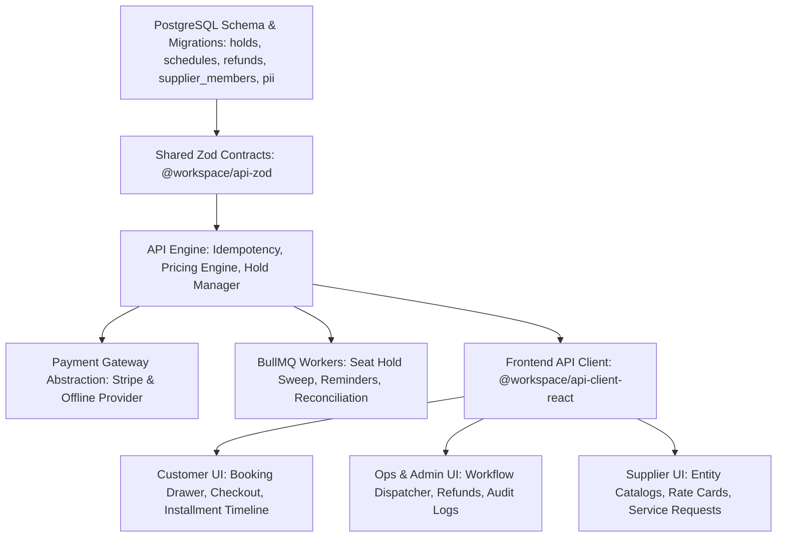

# Implementation Plan: TourOps Enterprise Platform (PRD Revision 1.1)

> **Document:** `tasks/plan.md`  
> **Source PRD:** [docs/prd-tourops-platform.md](file:///Users/wisnuflash/freelance/tourops-app/docs/prd-tourops-platform.md)  
> **Date:** October 17, 2026  
> **Status:** Active Plan  

---

## 1. Overview

TourOps is an end-to-end multi-portal Tour Operator ERP and customer booking platform. While foundational capabilities (catalog browsing, 19-role RBAC enforcement, base tour CRUD, and the sticky booking drawer UI) are completed, PRD Revision 1.1 mandates critical enterprise-grade enhancements:
1. **Capacity Hold & Idempotency:** 30-minute reservation holds with row-level locks (`SELECT FOR UPDATE`), per-minute expiry sweeps, and UUID-based idempotency.
2. **Dynamic Staged Installments (20/30/50 & 30/70 schemes):** Closing the booking-timing gap, guaranteeing mathematical exactness on the final installment, and real-time payment schedule synchronization.
3. **Late Payments & Cancellation/Refund Policies:** Automated grace period tracking (D+1, D+3), tiered refund calculations (≥91d: 100% - fee, 61-90d: 70%, 31-60d: 40%, ≤30d: 0%), and audit logging.
4. **Group Travel & Sensitive Data Security:** Alphanumeric join codes, party-size capacity bounds, and passport/medical PII encryption with UI masking.
5. **AI Itinerary Generator & Operations Dispatcher:** Deterministic geographic checks, mandatory draft review, and automated BullMQ background jobs.

---

## 2. Architecture Decisions & Invariants

- **Decision 1 (Authoritative Pricing & Preview):** Client-side price preview updates reactively in $\le 50\text{ms}$ using cached rates for smooth UX. At Step 3 (and prior to checkout creation), the client calls `POST /quotes` ($\le 300\text{ms}$ p95), which is authoritative. The server recalculates all components (adult, child ratio, room allocations, departure surcharges, single supplements, discounts, and taxes).
- **Decision 2 (Installment Invariant):** For any booking with installment schedule rows $S_1, S_2, \dots, S_n$, the system strictly enforces:
  $$\sum_{i=1}^{n} \text{amount}(S_i) = \text{totalPrice}$$
  All installments $S_1 \dots S_{n-1}$ are rounded to currency minor units (`ROUND_HALF_UP`), and the final installment is computed as $S_n = \text{totalPrice} - \sum_{i=1}^{n-1} S_i$.
- **Decision 3 (Seat Hold Invariant):** A booking in `pending_payment` decrements `tour_departures.capacityBooked` atomically inside a PostgreSQL transaction using `SELECT ... FOR UPDATE` with `hold_expires_at = NOW() + INTERVAL '30 minutes'`. A BullMQ/Cron scheduled worker sweeps expired holds every 60 seconds.
- **Decision 4 (Idempotent Webhooks & Requests):** `POST /bookings` mandates an `Idempotency-Key` header with 24-hour cache in Redis/PostgreSQL. Payment webhook events enforce a database unique constraint on `payment_events(provider, event_id)` processed in the same database transaction as the booking status update.
- **Decision 5 (PII & Data Protection):** Passport numbers, dates of birth, and traveler medical/dietary notes are encrypted at rest using AES-256-GCM. In UI views, passport numbers are masked (`XXXX-XXXX-1234`).
- **Decision 6 (Fail-Closed RBAC):** 19-role RBAC is enforced strictly server-side using `requireRole(...)`. Suppliers are row-scoped to their `supplier_entity_id`. Content editors have strict PATCH allowlists that forbid changing prices or publish states.

---

## 3. Dependency Graph

---

## 4. Phase Overview & Milestones

| Phase | Focus Areas | Primary User Stories | Target Checkpoint |
| :--- | :--- | :--- | :--- |
| **Phase 1d** | Staged Installments, Seat Holds, Idempotency, Refunds | US-01, US-02, US-03, US-04, US-06, US-07 | Checkpoint 1 & 2 |
| **Phase 2a** | Stripe Integration, Webhook Deduplication, Daily Reconciliation | US-05, US-04 | Checkpoint 3 |
| **Phase 2b** | Operations Workflow Dispatcher, Step Tracking, Email Reminders | US-10, US-11, US-12 | Checkpoint 4 |
| **Phase 2c** | Supplier Entity Isolation, Rate Cards, Self-Service Portal | US-09, US-14 | Checkpoint 5 |
| **Phase 3a** | Group Travel Enhancements, Join Codes, B2B Proposals | US-08, US-13 | Checkpoint 6 |
| **Phase 3b** | AI Itinerary Deterministic Validation & PWA Offline Companion | Section 8, Section 9 | Checkpoint 7 |

---

## 5. Risks and Mitigations

| Risk | Impact | Mitigation |
| :--- | :--- | :--- |
| **High-concurrency overbooking** | High | PostgreSQL `SELECT ... FOR UPDATE` row locks on `tour_departures` + database CHECK constraint `capacityBooked <= capacityTotal`. Concurrency stress tests with 200 parallel workers. |
| **Installment rounding discrepancy** | Medium | Invariant: final installment equals total minus preceding installments. Unit tests across all currencies (USD 2 decimals, IDR 0 decimals). |
| **Webhook replay & race conditions** | High | Compound unique key `(provider, event_id)` on `payment_events` with transaction rollback on error. |
| **Passport & Medical PII leak** | High | Application-level envelope encryption, UI masking, role-scoped access, and automated audit logging. |
| **AI Itinerary hallucinations** | Medium | Only allowed to reference supplied master data IDs; deterministic geographic cluster validation and mandatory `draft` status prior to admin review. |

---

## 6. Open Questions & Approvals Tracker

- [ ] **Q1 (Finance):** Formal confirmation of installment ratios (20/30/50 vs 30/70) and tiered refund percentage schedule.
- [ ] **Q2 (Engineering):** Add remaining 4 role codes from `user_role` enum into the documented RBAC permissions matrix.
- [ ] **Q3 (Finance/Legal):** Confirm tax-inclusive display rules and regional VAT/PB1 rates.
- [ ] **Q4 (Legal):** Data retention period for passport and medical notes under PDP Law / GDPR.
- [ ] **Q5 (Engineering):** Evaluate removing `SameSite=None` in favor of `SameSite=Lax` for non-embedded environments.
- [ ] **Q6 (Product):** Default OpenAI model tier and maximum cost threshold per AI tour generation.
